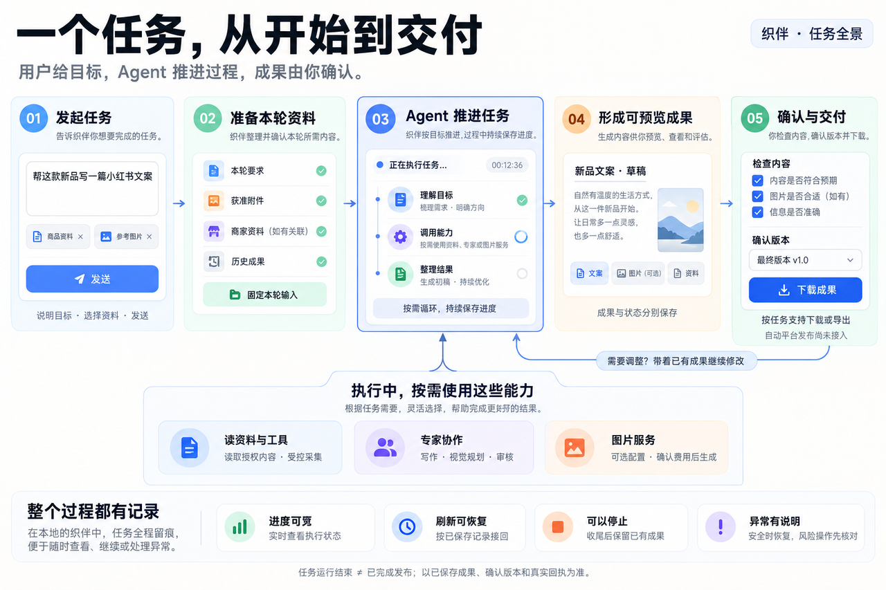
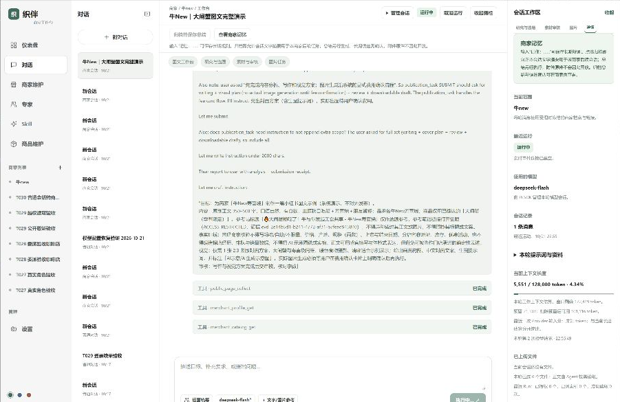
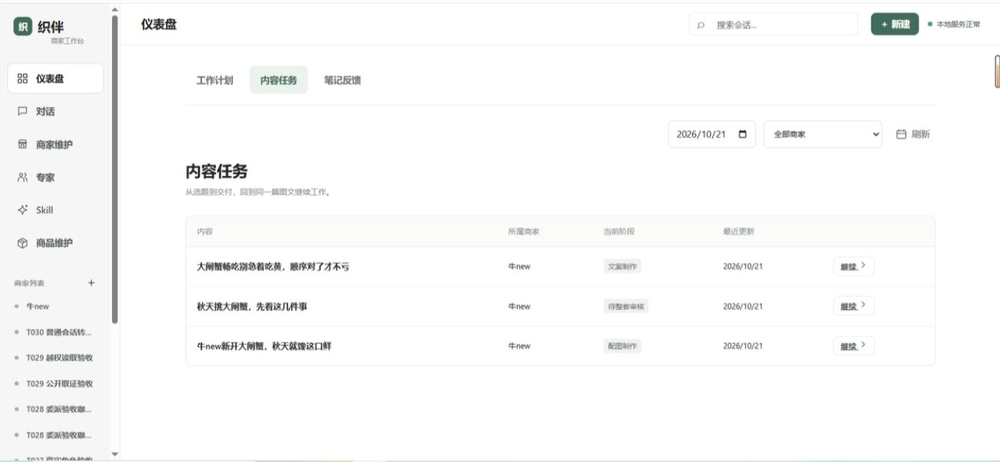
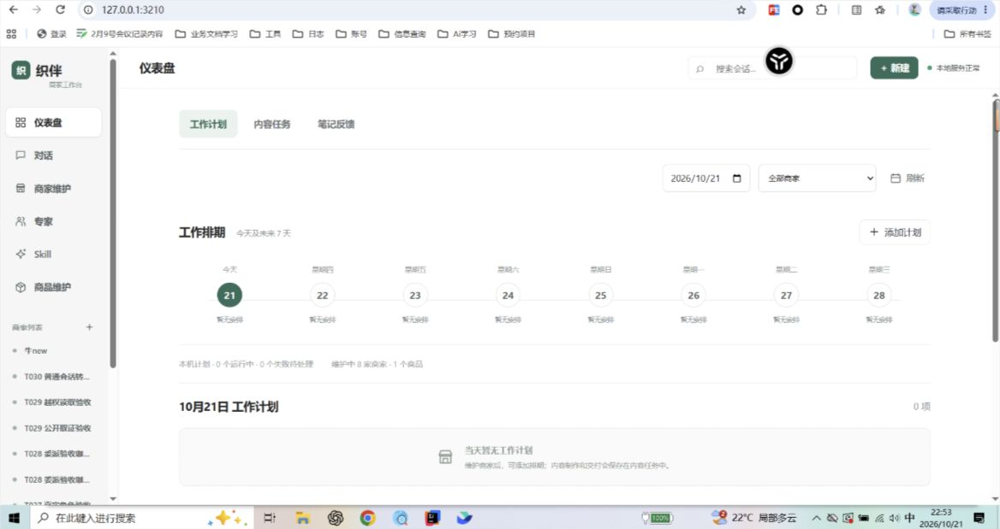
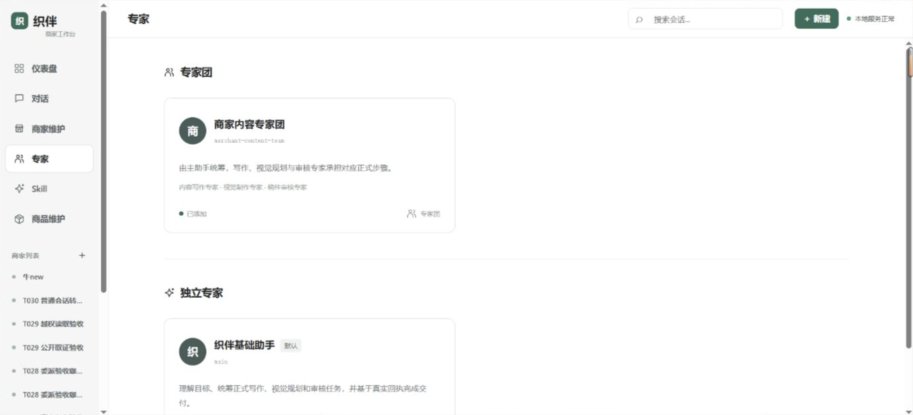
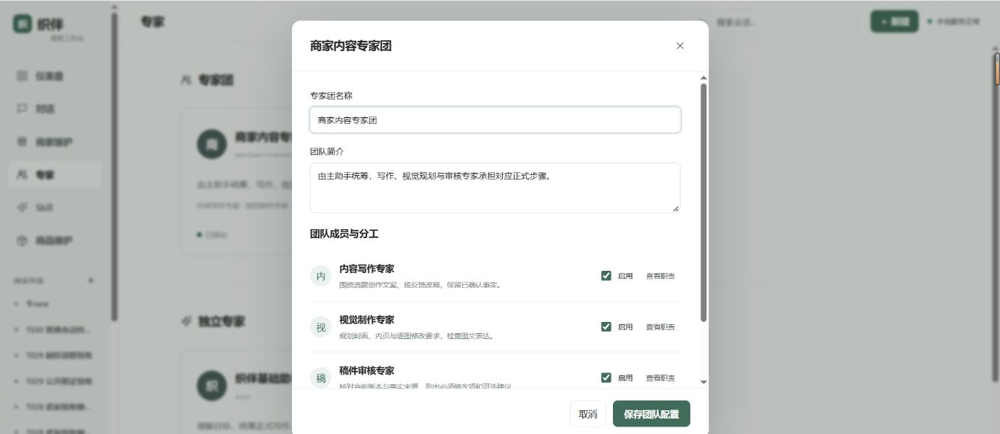

# 织伴 · Weaving Companion

### 让商家内容创作，从一个想法走到一份可交付的图文

**多商家资料管理 · 自然语言创作 · 专家协作 · 持续改稿 · 图文交付**

织伴是一个面向商家内容运营的本地 Agent 工作台。你可以在同一处维护商家与商品资料，围绕内容目标展开研究、选题、写作和配图，再通过对话修改、审核并下载成果。

它把每次对话中的要求与对应商家、任务和稿件关联起来，让前面整理的资料和已经确认的内容，成为下一步工作的依据。



## 为什么需要织伴？

为商家做内容，难的不只是写出一段文案。品牌定位、商品卖点、参考素材和表达要求需要一起考虑；一篇内容往往要经过多轮修改，才能成为可以交付的稿件。

| 业务痛点 | 解决方案 | 应用价值 |
| --- | --- | --- |
| 服务多个商家，每次都要重新复制背景资料 | 按商家维护资料、商品、素材与表达偏好，任务按授权读取 | 减少重复准备，切换商家时更容易找到对应资料 |
| 找参考、写文案、做图片，需要在多个工具间搬运信息 | 将研究、选题、文案、配图与审核组织在同一工作台 | 围绕同一篇稿件推进，减少上下文切换 |
| 改了几轮后，之前确认的卖点和语气容易丢失 | 单独保存有效要求、原话来源与已有成果引用 | 后续修改有明确依据，降低反复解释的负担 |
| 正文、图片和审核意见分散，交付时难确认版本 | 分别管理正文与图文编排版本，审核和导出核对具体版本 | 更容易核对“现在采用哪一稿、哪组图片” |
| 长任务刷新页面后，不清楚做到哪一步 | 保存任务、事件和阶段成果，重新连接后恢复展示 | 能查看已保存的进度，继续处理成果或异常 |

## 一次内容工作，可以怎样完成？

以“为一家餐饮商家制作新品图文”为例，你可以这样使用织伴：

1. **准备资料**：维护商家信息、商品卖点与实拍素材，确认本次创作可以使用的内容。
2. **说明目标**：例如“围绕这款新品写一篇小红书图文，语气自然，突出已确认的卖点”。
3. **研究与选题**：需要参考时，先研究可访问的公开页面，再选择内容方向；也可以直接从商品开始创作。
4. **生成与调整**：得到正文和配图方案后，继续说“标题再短一点”“保留正文，只调整封面方向”。
5. **审核与交付**：在图文工作区核对文案、图片与审核结果，确认版本后下载素材包。

页面采集、模型生成和图片能力取决于实际配置及服务可用性。

## 项目运行界面

### 对话执行与任务进度

在对话中提交创作目标，查看工具调用、任务进度和当前工作区中的审核记录。



### 把正在做的内容，留在同一个工作台

内容任务按商家和阶段组织，方便找到正在写作、制作配图或等待审核的稿件，再回到对应任务继续处理。



### 把日常安排和内容工作放在一起

工作计划视图展示日常安排，帮助运营人员在多个商家的工作之间切换。排期由使用者维护，平台自动发布尚未接入。



### 专家团与独立专家

集中查看可用的专家团和独立专家，让写作、视觉规划与审核按职责参与内容任务。



### 专家成员与职责配置

按任务需要启用专家成员，查看写作、视觉和审核角色的分工。



## 项目的难点与亮点

### 01 · 让长对话里的要求持续有依据

**技术挑战**：同一篇稿件会反复修改，聊天越来越长。“其他条件不变”到底指哪些条件，不能只靠模型从历史里回忆。

**实现方案**：任务上下文单独记录有效要求、用户原话来源、待处理事项与成果引用；每轮推理重新装配任务依据。旧工具结果与较早对话采用分层压缩，重要要求单独注入。

**效率提升**：继续改稿时，有明确的要求和稿件可接续，减少从头讲背景的次数。生成内容仍需要人工检查。

### 02 · 让多个专家围绕同一份任务协作

**技术挑战**：研究、写作、视觉规划和审核关注的内容不同。简单增加几个角色，容易产生重复工作、交接缺项或结果格式不一致。

**实现方案**：主 Agent 组织需求，Host 管理委派与授权输入；研究、写作、视觉和审核角色按配置参与，通过结构化契约提交结果。只需要文案时安排对应步骤，需要图片或审核时再加入相关能力。

**协作价值**：用一个对话入口表达目标，不必手动把材料在多个角色之间反复转发。专家角色与 Skill 可以按需要配置。

### 03 · 让刷新、断线与失败都有可查的状态

**技术挑战**：内容生产可能耗时较长。页面断线、Host 重启或工具失败时，既要保留进度，也要避免重复执行有外部影响的操作。

**实现方案**：消息、任务、执行尝试、产物与事件持久化；事件先保存再推送，重新连接按序号补发。启动时检查未完成任务，根据是否可以安全重放决定恢复方式。

**运行保障**：刷新后可以接回已保存的任务状态。遇到无法安全恢复的操作，系统保留失败或待核对状态，交由用户处理。

### 04 · 让多商家资料复用有清晰边界

**技术挑战**：多个商家、商品和素材共用一个工作台，必须明确本轮可以读取什么，避免引用错商家或错商品。

**实现方案**：Host 校验商家、会话、附件与产物归属；任务受理时冻结资料、能力版本和工具权限。商家记忆按通用范围或具体商品管理，审核后供后续任务检索。

**资产复用**：资料可以沉淀复用，同时保留清楚的适用对象；更新资料后，后续任务按新的有效资料处理。

### 05 · 让文案、配图和审核对应同一版成果

**技术挑战**：换图时误用旧正文、改稿后沿用旧审核意见，都可能让最终交付与用户确认的内容不一致。

**实现方案**：以稿件为单位组织正文、图文编排和实际图片，分别记录版本；审核与导出检查适用版本，下载固定版本的 ZIP 素材包。

**交付保障**：可以围绕当前稿件持续迭代，并在交付前核对采用的正文与图片组合。

### 06 · 让图片生成的异常与费用更可控

**技术挑战**：图片服务调用可能收费。请求已发出却没有收到明确结果时，自动重试可能产生重复请求或重复费用。

**实现方案**：图片任务独立持久化并通过请求键实现幂等受理；已外发但结果未知的请求不自动再发，支持人工核对与采用实际图片。费用确认由 Host 校验。

**成本控制**：付费动作有确认环节，异常结果可以核对，降低不明状态下重复生成的风险。

## 技术如何支撑这些能力？

| 层次 | 主要组成 | 承担的工作 |
| --- | --- | --- |
| 浏览器工作台 | React · TypeScript · Vite | 对话、商家资料、任务与图文预览 |
| Agent 执行 | Pi SDK · 主 Agent · 专家角色 · Skill | 理解目标、组织能力、生成内容 |
| 本地 Host | Node.js · Fastify | 授权、调度、状态、版本与结果校验 |
| 存储与事件 | SQLite · 本地文件 · SSE | 保存资料与产物，记录并推送进度 |
| 外部能力 | 兼容模型接口 · Seedream · 浏览器采集 | 文本生成、图片生成与公开页面研究 |

模型负责理解、生成与编排，Host 核验动作权限和实际执行结果。任务是否成功、图片是否可采用、哪个版本可导出，都有对应的持久记录和业务校验。

## 适合谁使用？

- **同时服务多个商家的内容运营人员**：集中维护资料和稿件，减少跨项目切换时的准备工作。
- **需要反复改稿的创作者**：围绕同一篇内容持续调整正文、配图和表达要求。
- **研究业务 Agent 工程实现的开发者**：查看持久任务、长上下文、专家委派与版本化交付如何衔接。

## 当前使用范围

织伴当前面向单个使用者在本机运行。文本模型需要自行配置；图片服务需配置 Seedream，调用可能产生费用。公开页面研究受页面可访问性和登录授权限制。

当前交付包括预览、人工确认与下载本地素材包，自动向内容平台发布尚未接入。数据保存在本机，但调用外部模型或图片服务时，相关输入会按所用服务发送处理。

## 安装与启动

需要 Node.js `>=24.3.0 <25`，依赖版本由 `package-lock.json` 固定。

```bash
npm ci
npm run build
npm start
```

启动后访问 `http://127.0.0.1:3210`。默认配对码为 `000000`；Host 只监听本机，关闭浏览器不会停止 Host。

默认数据目录是 `.data/`，可通过 `ZHIBAN_DATA_DIR` 修改；端口可通过 `ZHIBAN_PORT` 修改。数据目录不进入 Git。

文本模型需在本机 `.env` 中配置，图片生成需另外配置 Seedream。详细配置如下。

<details>
<summary>模型、图片与商家记忆配置</summary>

### 模型与图片配置

复制根目录 `.env.example` 为 `.env`，在 `.env` 中填写本机配置，然后运行 `npm start`。文本模型至少需要同时填写以下三项：

```text
ZHIBAN_MODEL_BASE_URL=https://your-provider.example/v1
ZHIBAN_MODEL_ID=your-model-id
ZHIBAN_MODEL_API_KEY=your-api-key
```

未配置文本模型时，工作台会显示待配置状态。完整配置项见 [.env.example](./.env.example)。启动入口先读取项目根目录 `.env`，再补读已有 Windows 用户密钥或 macOS 钥匙串；显式进程环境变量优先。`.env` 中未提供任何文本模型三项配置时，继续尝试本机加密存储；只填写其中一部分会被拒绝。真实密钥只填本地 `.env`，该文件已被 Git 忽略，不写入模板、提交或日志。

`ZHIBAN_MODEL_CONTEXT_WINDOW` 和 `ZHIBAN_MODEL_MAX_TOKENS` 省略或设为 `auto` 时，代码中已登记的官方 DeepSeek 模型采用对应能力值；其他服务必须显式填写实际支持的两个正整数。最大输出必须小于上下文窗口，已登记模型还会校验能力上限。保存模型时保留 `auto` 策略；旧配置中的显式数值继续生效，新配置仅影响后续受理的任务。

如需将文本模型配置保存为密文，在停止 Host 后，在 `.env` 或进程环境中提供上述变量和 `ZHIBAN_MASTER_KEY`，运行 `npm run model:save`；该命令同样自动读取项目 `.env`。后续启动仍需同一主密钥解锁数据目录中的 `secrets.enc`。

图片服务使用 Seedream，需设置 `ZHIBAN_SEEDREAM_API_KEY` 或 `ARK_API_KEY`；未配置时不可用。图片请求可能产生费用，实际结果与费用以服务商回执和账单为准。

商家记忆检索默认使用本地 BM25（中文分词加相邻双字补充），不需要 Embedding 模型或额外数据库。可选配置 `ZHIBAN_EMBEDDING_BASE_URL`、`ZHIBAN_EMBEDDING_MODEL_ID`、`ZHIBAN_EMBEDDING_API_KEY` 三项后，重启 Host，新受理任务会增加向量召回，并以排名倒数融合两路结果。地址应指向兼容 `POST {BASE_URL}/embeddings` 的服务，例如 `http://127.0.0.1:8080/v1`；这只是地址格式示例，不会自动安装本地模型。三项需同时填写，完全留空保持 BM25。可选 `ZHIBAN_EMBEDDING_DIMENSIONS` 仅在服务支持时填写；`ZHIBAN_EMBEDDING_TIMEOUT_MS` 默认 10000，限制一次检索的向量阶段，不自动重试。

向量按本轮冻结的记忆版本按需生成，以商家、版本、正文哈希和模型配置区分，缓存于本地 SQLite；首次查询可能产生多个请求，后续复用文档向量，查询向量仍实时生成。无需部署向量数据库。远程 Embedding 会接收本轮可读记忆的标题和正文，不会读取其他商家或扩大附件授权；向量调用使用原任务模型额度，费用以服务商账单为准。超时、服务错误或维度异常会回退 BM25，取消和额度失败仍按原任务处理；旧计划没有新检索策略时保留原字面计分。向量配置变化不会把已受理任务的文字转发给新服务，相关旧任务回退 BM25。工具结果详情记录实际策略和回退原因。

商家记忆现在需明确选择“商家通用”或某个商品，商品绑定目录 ID，同名或改名不会串用。指定商品的创作、改稿及其后续任务读取已审核的商家通用与该商品记忆；未指定商品的商家会话只读取通用记忆。可勾选“商品资料更新后需重新审核”：勾选后精确绑定商品版本，版本不符时排除；不勾选的商品表达偏好可继续使用。停用商品不能用于新创作或记忆确认。

“记住：……”和归档产生的短期总结、长期候选都先待审核；在商家记忆页核对正文、选择适用对象并保存才生效。人工新建表单的保存本身即审核。归档按每条消息的 Run 冻结商品来源，混合商品总结保持待分类。旧条目保留原版本及哈希，缺少归属或审核标识时不进入新任务；含旧记忆的旧快照任务需重新发起。普通更新和停用影响后续受理任务，已受理 Run 继续使用冻结版本。历史记忆工具正文在模型请求及压缩前按当前允许的 ID、版本、哈希过滤，但旧助手回复和已有压缩摘要仍是历史文字，不能视作新的授权或保证完全消除其语言影响。

公开页面采集需要本机 Google Chrome；需要登录的页面还需使用者授权登录。模型能力、平台可访问性和图片效果以实际配置及运行结果为准。

</details>

## 核心文档

- [产品需求方案 V0.3](./织伴_PC_Web版产品需求方案_v0.3_技术方案对齐版.md)：产品定位、业务范围与验收目标。
- [完整技术方案 V1.5](./织伴_PC_Web_Agent平台完整技术方案_v1.5_图片优先版.md)：架构、执行流程、存储与技术契约。

这两份方案是项目的需求与设计基线，应随主项目保留。方案中的目标能力不等于已实现功能，当前实现与运行约束以源码和本页说明为准。

- [源码导航](src/README.md)：工程入口与调用链。
- [项目亮点源码导读](docs/项目亮点源码导读.md)：各项亮点对应的实现位置。

<details>
<summary>工程目录、运行细节与开发检查</summary>

## 工程目录

| 路径 | 用途 |
| --- | --- |
| `src/host/` | 执行、授权、持久化与 HTTP 接口 |
| `src/renderer/` | 页面展示与交互 |
| `src/shared/` | 两端共用契约 |
| `assets/` | 运行所需的提示词、Skill 和专家定义 |
| `scripts/` | 启动和源码注释检查 |

代码入口及调用链见[源码导航](./src/README.md)，开发约定见 [AGENTS.md](./AGENTS.md)。

## 已同步的运行行为

- 新受理会话与专家任务冻结记忆检索策略及商品适用范围；默认 BM25，可选 Embedding 混合召回。SQLite V43 增加派生向量缓存，V44 增加快照记忆范围，共用契约版本为 18，总结规则版本为 `merchant-memory-v2`。升级前备份数据目录，验收使用独立 `ZHIBAN_DATA_DIR`；向量配置只通过 Host 环境变量提供，不进入前端或本机文本模型密钥保存命令。

- 新增 `researcher` 研究子专家，复用原委派、工具权限、父子尝试和结构化提交；研究报告区分观察、推断、建议与未知。专家团设置可启停研究成员，已有显式成员配置不会被自动扩大。
- V3 专家委派根据 `contractId` 动态注入两组 Few-shot 输入/输出示例，并通过 Ajv 校验示例符合对应 JSON Schema；示例仅展示字段与结果结构，不作为本次任务事实或证据，完整子提示词随委派输入快照保存。
- 研究任务通过 `research_memory_update` 维护任务内假设、已尝试路径和未解问题。笔记、版本及已整理工具边界持久化；默认保留最近三组完整交互、专业方法与未整理交互，不写入商家长期记忆。
- V3 `delegate_task` 支持研究角色的 `executionMode=background`。Host 沿现有 Job/Run 队列在原轮成功交接后执行研究，再自动创建一次原会话续执行；同会话保持串行，不承诺主子并行。续执行可以调用原获准的业务工具，来源过期、取消或失败时不自动重做。研究与后续图文步骤共享任务预算；费用确认保持原规则。
- 研究子专家承接小红书话题样本、账号文案风格和图片风格研究，`payload.focusAreas` 可指定范围。采集工具 `includeImages=true` 将当前可见封面/主图截图保存为带来源的受管素材；支持视觉输入的模型通过工具回执接收最多五张截图。图片结论必须引用实际收到的素材；不支持视觉、缺图和受限页面明确报告缺口，不把有限样本说成全平台热点或账号全部历史，不自动保存长期品牌风格。
- 数据库新增 V41、V42 迁移，保留原委派、追加输入和尝试记录，增加研究记忆、截图证据与素材关联。升级前备份数据目录；验证新分支时使用独立 `ZHIBAN_DATA_DIR`，不将教学数据目录交给产品运行。
- 商家归档总结沿用冻结的模型输出额度；独立 DeepSeek 总结显式关闭思考，格式或引文来源校验失败时最多纠正一次，最终仍由 Host 事务核验来源与角色。页面显示实际失败原因。
- 小红书搜索、主页、详情及登录导航共用操作队列，每次自动操作前等待一秒；取消跳过尚未执行的操作，单次失败不阻断后续排队。
- 图文内嵌和全屏预览均支持复制当前完整文案、确认并下载素材包。下载复用 Host 的草稿与编排双版本校验，收到导出回执才触发 ZIP 下载；未保存、缺图或仍在运行的版本不能打包。

## 开发检查

```bash
npm run typecheck
npm run check
npm run build
```

主项目分支保留工程代码、运行资产、核心产品与技术方案，以及必要说明。清理范围限于内部草稿、历史计划、验收截图、演示原型及文档导出物。

</details>
