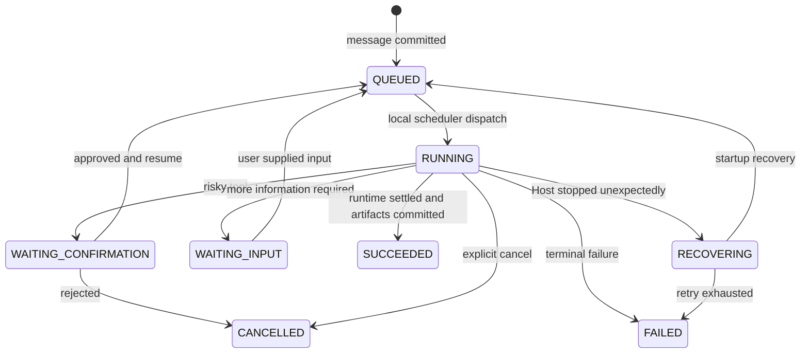
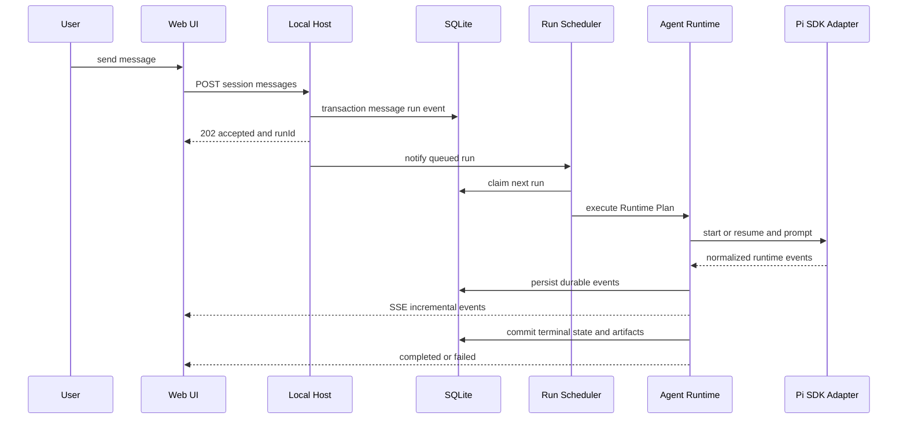

# 织伴 Agent PC Web 本地工作台技术方案

> 2026-10-18 实现修订：浏览器与 Host 的实时事件改为 SSE，REST 保留命令；AgentTaskManager 管理每会话唯一未结束主 Run 与完整退出。新消息忙碌返回 409，升级前已有队列保留串行消化。以下历史队列/状态设计须结合执行 T012、T014～T016 和项目维护指南的本次契约阅读。

> 版本：V1.5（Pi 单内核、图片优先实施范围，2026-10-15 校订）  
> 对齐需求：[织伴 Agent PC Web 产品需求方案 V0.3](./织伴_PC_Web版产品需求方案_v0.3_技术方案对齐版.md)  
> 工程性质：全新独立仓库、独立实现、单机部署，通过本机浏览器访问  

# 基本信息

| 基本信息 | 内容 |
|---|---|
| 产品名 | 织伴 Agent |
| 工程建议名 | `zhiban-agent` |
| 使用方式 | 用户启动本地服务后访问 `http://127.0.0.1:<port>` |
| 运行形态 | 单机 Node.js Host，浏览器仅承担 UI；关闭页面不终止后台任务 |
| 技术栈 | Node.js 24.x + TypeScript 5.9 + React 19.2 + Vite 8 + Fastify 5 + SSE + SQLite |
| 本地存储 | SQLite + Content-addressed Blob + JSONL Audit + 隔离 Workspace |
| Agent 内核 | 项目自有 Runtime 治理层 + Pi SDK 适配器，本期只支持 Pi SDK |
| 工程基线 | npm lockfile + TypeScript strict + Biome 2 + Vitest 4 + AJV 8/JSON Schema |
| 运行边界 | 用户通过命令启动 Node.js Host，再使用本机浏览器访问 |
| 用户模型 | 单机单使用者，可在同一本地实例中管理多个商家；织伴 Agent 不建设独立用户账号体系 |
| 浏览器范围 | 首版验收最新版 Chrome 与 Edge；Safari、Firefox 不作为首版专项兼容目标 |
| 明确不依赖 | MySQL、Redis、BullMQ、S3、Kubernetes、分布式锁和中心化执行平台 |
| 方案负责人 | 织伴 Agent 项目研发负责人 |

# 一 概述

## 1.1 结论

织伴 Agent 采用本机 Node.js 服务与本机浏览器协作的单机架构。用户主动启动织伴 Agent Host，Host 只监听回环地址，并同时提供 React 静态页面、REST API、SSE 事件流、Agent Runtime、本地任务调度、浏览器自动化、文件处理和数据持久化。

页面刷新或关闭后，本地 Host 继续运行 Agent 任务。用户重新打开页面时，前端通过 Host API 读取 SQLite 中的会话、Run 和事件游标，再通过 SSE 接收实时增量。

本方案定义本期实现与验收范围：媒体创作仅包含图片生成与改图。功能、技术选型、状态、接口、数据表、事件和恢复规则按正文实施；调整时同步修改契约、迁移与验收口径。

不建设中心化 API、独立 Worker 集群或共享基础设施。单机可靠性依靠 SQLite 事务、持久化运行状态、Worker Thread 隔离、启动恢复、隔离 Workspace、幂等命令和领域补偿实现。

## 1.2 术语

| 术语 | 定义 |
|---|---|
| Local Host | 本机 Node.js 主进程，承载 HTTP、SSE、Agent Runtime、任务调度和本地存储 |
| Web UI | 浏览器中的 React 工作台，仅通过 localhost API 与 Host 通信 |
| Agent Runtime | 项目内的执行治理层，统一会话生命周期、Agent Loop、Tool Loop、Compact、Resume 和取消语义 |
| Pi SDK 适配器 | 隔离 Pi SDK 原生会话、工具和事件，向 Agent Runtime 提供稳定接口 |
| Session | 绑定一个商家或普通工作空间的会话，是消息、专家、工具、Workspace 和 Artifact 的归属边界 |
| Run | 一次用户输入触发的逻辑执行，可包含多个 SDK attempt |
| Runtime Event | Host 定义的稳定运行事件，不直接暴露具体 SDK 的原始事件 |
| Artifact | Agent 生成并登记的文案、报告、图片或其他文件 |
| Blob | 按内容 hash 保存的附件或大对象，供多个会话安全引用 |
| Workspace | 每个 Session 或 Run 的本地隔离文件目录 |
| Event Cursor | Session 内递增事件序号，用于页面重连后的补拉、排序和去重 |
| Work Item | 面向用户的待办、问题、确认、执行任务和领域人工处置的统一查询投影，不作为单一事实源 |
| Capability Asset | Expert、Expert Group、Skill、Tool、Plugin、Workflow 等可版本化、可校验、可装配资产 |
| Browser Capability | 浏览器提供的上传、下载、剪贴板和页面通知能力；受浏览器权限与页面生命周期约束 |
| Local Operator | 当前本地实例的唯一使用者，不对应中心化租户或产品云账号 |

## 1.3 本期目标

| 序号 | 目标 | 完成口径 |
|---|---|---|
| 1 | 完整本地 Web 工作台 | 启动 Host 后可完成普通会话、商家工作台、资产、自动化、画布、产物、事件和设置操作 |
| 2 | 本地后台执行 | 页面关闭后任务继续，Host 重启后可识别并恢复未完成 Run |
| 3 | Pi SDK 执行内核 | Runtime 通过 PiRuntimePort 使用 Pi SDK；SDK 原始类型不越过适配边界 |
| 4 | 本地数据可靠 | 消息、Run、事件和确认写入 SQLite；附件与产物可追踪、可恢复 |
| 5 | 文件安全隔离 | Agent 只访问授权 Workspace；上传、预览、下载均经过路径和 MIME 校验 |
| 6 | 可靠事件流 | SSE 支持断线重连，按 cursor 从 SQLite 补历史事件 |
| 7 | 本期能力闭环 | 本方案本期能力矩阵中的每一项都有页面、接口、事件、数据、恢复与验收落点 |
| 8 | 本地 Web 能力闭环 | 通过浏览器完成上传、下载、剪贴板和页面通知，通过 Host 完成浏览器自动化、文件存储和数据恢复 |
| 9 | 独立交付 | 新仓库不引用其他工程源码、私有类型、内部数据库结构或未声明运行依赖 |

## 1.4 核心技术决策

1. 使用单机模块化单体，Host 只绑定本机回环地址，不拆 API 与 Worker 服务。
2. React 页面通过 localhost REST 提交命令，通过 SSE 接收领域事件；模型侧流式协议由 Provider Adapter/Pi SDK 适配器消费。
3. SQLite 是会话、消息、Run、事件、确认和 Artifact 元数据的事实源；数据库命令固定运行在 Worker Thread。
4. Blob、Artifact 文件和 Workspace 使用本地文件系统，数据库只存索引、hash 和相对路径。
5. 内存队列负责当前进程调度，持久领域状态负责重启恢复；同一 Session 只运行一个主动 Run。
6. Runtime 通过 PiRuntimePort 接入 Pi SDK，Web UI 不接触 SDK 原始事件。
7. 单机单使用者、多商家；外部登录只服务模型或业务 Adapter。

# 二 业务范围

## 2.1 完整用户闭环

1. 用户启动织伴 Agent 本地服务。
2. 浏览器访问 Host 输出的 localhost 地址；首次访问输入终端显示的一次性配对码，成功后建立本机 Cookie。
3. 用户进入普通会话，或选择商家进入商家总览并创建商家会话。
4. 系统按用户配置和资产版本确定 Expert、Expert Group、Skill、Tool、Plugin 和模型，执行内核固定为 Pi SDK。
5. 用户输入目标或上传附件。
6. Host 先持久化消息和 Run，再加入本地调度队列。
7. Agent Runtime 执行并持续产生标准事件。
8. 高风险操作进入 Confirmation，用户批准或拒绝后继续。
9. 子 Agent、Canvas、图片任务、浏览器、数据查询、Delivery 和定时任务按各自领域状态机执行。
10. 输出文件登记为 Artifact，可预览、下载、进入 Canvas 或发起 Delivery。
11. 页面刷新或关闭后再次进入，可从已持久化状态继续查看。
12. Host 重启后，所有非终态领域任务按恢复策略进入继续、重试、等待人工或明确失败状态。

## 2.2 Run 状态机



## 2.3 业务规则

1. 会话是专家、模型、Skill、Tool、文件和执行状态的最小隔离单元。
2. 本期会话固定使用 Pi SDK；Run 保存所用 Pi SDK 适配器版本，运行中不切换执行内核。
3. Run 开始时生成不可变 Runtime Plan，保存专家、Skill、Tool、模型和 Pi SDK 适配器版本快照。
4. 同一会话只串行执行一个 Run；不同会话允许受控并发。
5. 用户关闭页面不取消任务；只有显式取消、Host 停止或策略超时才中断。
6. 大内容和文件不进入 SSE payload，通过 Blob 或 Artifact 引用传递。
7. 产物文件写入完成且 Artifact 记录提交后，才能展示为成功。
8. Expert、Skill、Tool、Plugin 和 Workflow 必须记录不可变版本与 checksum，Run 只使用已解析快照。
9. 子 Agent 使用独立 Attempt、Workspace 和结果协议；父会话只消费结构化结果和显式产物。
10. 所有具有外部副作用的命令必须定义 idempotency key、提交承诺和重启恢复策略。
11. 运行中修改模型或 Expert 不修改当前 Run，只影响后续 Run；需要即时切换时创建新分支。
12. 不实现跨设备同步、远程配置或远程任务收发；外部业务数据只通过 Adapter 形成带来源和时效的本地安全投影。

## 2.4 本期功能矩阵

下表是本期实现范围。列出的能力须具备 UI、Application Service、Store/Adapter、REST/SSE Contract、恢复规则和验收落点。

| 能力域 | 必须实现的功能 | 事实源 | 关键验收 |
|---|---|---|---|
| 工作台壳层 | Dashboard、侧栏、全局搜索、右侧 Inspector、设置、错误与恢复入口 | URL + Host Read Model | 刷新后导航和选择状态一致 |
| 普通会话 | 创建、列表、标题、聊天、附件、配置、归档、恢复、删除、Fork、搜索、未读 | Conversation Store | 长会话分页、搜索、Fork 和恢复通过 |
| 商家工作台 | 商家创建/删除、备注名、画像、知识、会话、待办、内容计划、数据概览、最近活动 | Merchant Stores | 商家隔离、跨商家读取和写入策略正确 |
| 小红书内容分析与选题 | 按需分析历史内容、关键词、真实热点、竞品内容差异及商家动态；选题、可选报告、建议转行动 | Analysis/Content Plan Stores + Artifact | 来源与缺口可追溯，人工资料不被覆盖，失败不替换成功版本 |
| Runtime | 流式对话、Agent Loop、Tool Loop、Compact、Resume、Cancel、Snapshot 与 Pi SDK 适配 | Run + Runtime Snapshot | Pi SDK 生命周期与恢复 Contract Test 通过 |
| Expert | Expert、Expert Group、默认选择、会话切换、调用策略、工作流绑定 | Capability Registry | 版本固定、依赖解析和回滚通过 |
| Skill | 标准目录包、安装、删除、启停、版本、更新、私有依赖、运行时渐进加载 | Capability Registry + Files | checksum、依赖锁和运行 provenance 完整 |
| Tool | 基础文件、搜索、Shell、Web、业务工具、渐进发现、Schema、Policy、审计 | Tool Catalog + Audit | 未授权工具不可执行，高风险操作可恢复确认 |
| Plugin | 发现、依赖探测、安装引导、启用、禁用、健康检查和 Skill 注入 | Plugin Registry | 缺依赖、版本不兼容和降级行为明确 |
| Work Item | 用户问题、Confirmation、待办、人工处置、运行状态聚合 | 各领域 Store 的统一投影 | 查询不建立第二事实源 |
| 多 Agent | Delegate、Child Run、并发槽、steer、question、resume、abort、parent wake、结果回传 | Delegation + Collaboration Stores | 子任务崩溃和父唤醒对账通过 |
| 自动化 | 本地定时任务 CRUD、启停、立即运行、Run 历史、提醒和一次性/周期性触发 | Schedule Stores | 重启补偿、重复触发和时区测试通过 |
| Artifact | 自动发现、登记、列表、浏览器预览、下载、来源、版本、清理和引用 | Artifact Registry + Blob/Files | 文件与索引提交承诺一致 |
| Delivery | 目标渠道、投递记录、回执、失败重试、人工处置、去重与补偿 | Delivery Store | 外部成功但本地失败可对账修复 |
| Canvas | 文档、Snapshot、Selection、Command、ACK、图片插入、生成/改图、导出、Workflow | Canvas Store + Workspace | 页面刷新、命令恢复和图片引用稳定 |
| 图片创作 | 文生图、参考图改图、Canvas 圈选改图、图片引用、任务状态、取消和产物登记 | Image Media Task + Artifact | 参考图校验、超时/重启恢复、重复请求保护、费用前确认 |
| 浏览器工作区 | 会话隔离、导航、登录态、截图/DOM、下载、媒体发现、Computer Use | Browser Session + Host Runtime | 域名策略、Cookie 隔离和崩溃恢复通过 |
| 数据与业务 Adapter | 数据查询、诊断、经营分析、内容计划、发布和外部系统操作 | Adapter Store + Downstream Receipt | 请求脱敏、幂等、错误翻译和审计完整 |
| 模型网关 | 登录、PAT/浏览器认证、模型目录、别名、偏好、健康检查、重试和用量摘要 | Secret Store + Local Preferences | 凭证不进入前端、日志和会话数据 |
| 本地 Web 能力 | 浏览器上传、下载、剪贴板、页面通知、终端日志和手动升级 | Web API + Local Host | Chrome/Edge 本地访问行为验收通过 |
| 本机自检 | 启动迁移、数据健康、网络、版本兼容和脱敏日志导出 | Operation Stores + Logs | 只服务故障定位，不建设分析与自动优化平台 |

## 2.5 功能一致性门禁

1. 每个能力必须分配唯一 Owner、唯一持久事实源和唯一外部 Adapter 边界。
2. 每个用户动作必须能映射到页面入口、HTTP 命令、领域方法、持久状态和结果事件。
3. 每个非终态对象必须定义启动恢复动作，不允许以“重启后丢失”作为默认行为。
4. 每个外部副作用必须定义幂等键、回执和对账方式。
5. 每个页面必须定义 loading、empty、running、recovering、error 和 permission-denied 状态。
6. 实现缺少本期矩阵能力时，只能标记为未完成；范围变更须记录版本、影响和验收口径。

# 三 系统设计

## 3.1 技术架构总览

浏览器通过 REST 向本地 Host 提交命令，通过 SSE 接收标准领域事件并按 cursor 补拉。Host 调用首个 OpenAI-compatible 模型 Adapter 时使用 HTTP/SSE 流式响应；其他模型 Provider 由相应 Adapter 消费原生协议，Pi SDK 事件由 PiRuntimePort 转换为 Runtime Event。这是两段独立链路。

| 层次 | 组件与技术 | 职责与连接 |
|---|---|---|
| 本机浏览器 | React 19.2、Vite 8、TypeScript 5.9、TanStack Query、tldraw 5.2 | 展示会话、商家内容分析/选题、内容、图片、Canvas、产物和交付状态；不保存领域事实或供应商凭证 |
| 接入层 | Fastify 5、同源静态资源、REST、原生 HTTP SSE | REST 接收命令与读取状态；SSE 推送已归一化的领域事件，重连按 cursor 补拉 |
| 应用与领域层 | Application Service、Run Scheduler、诊断、内容计划、Artifact、Delivery、Confirmation、自动化 | 持久化命令、执行业务状态机、并发限制、审批、外部副作用和重启恢复 |
| Agent 执行层 | Agent Core、AgentRuntimeEngine、PiRuntimePort、PiSdkRuntimeAdapter | 组装上下文与能力快照，使用 Pi SDK 执行 Agent/Tool Loop、压缩、取消和恢复 |
| 外部适配层 | ModelPort、图片 Provider Adapter、业务与 Delivery Adapter、Playwright Chromium | 文本模型首个 OpenAI-compatible 接入使用 HTTP/SSE；图片生成/改图和授权业务查询按 Adapter 契约接入；对外发布取得回执 |
| 本地数据层 | node:sqlite WAL/FTS5（单 DB Worker Thread）、Blob、隔离 Workspace、JSONL Audit、加密 SecretStore | 保存唯一事实源、文件、审计和凭证，支持迁移、备份、对账与恢复 |

主链路为：浏览器 REST 提交命令 → Host 持久化 Run → Scheduler/Runtime 执行 → Adapter/Pi SDK 消费模型或业务结果 → Host 持久化领域事件与 Artifact → SSE 推送到浏览器。小红书内容分析/选题、内容草稿与图片创作可分别从会话或商家入口发起；分析报告建议仅在用户确认后转成待办、内容计划或新的 Agent 任务，直接选题创作不要求报告。

## 3.2 代码结构

新仓库采用单 package、单 Host 的 TypeScript 工程，不创建微服务式空包：

```text
zhiban-agent/
├── src/
│   ├── host/
│   │   ├── bootstrap/                 # Composition Root、启动恢复和优雅关闭
│   │   ├── http/                      # Fastify routes、鉴权、静态资源和上传下载
│   │   ├── websocket/                 # 连接管理、cursor 补拉和事件推送
│   │   ├── runtime/                   # Agent Runtime、Runtime Plan、Pi SDK 适配器
│   │   ├── sessions/                  # 会话、消息和运行用例
│   │   ├── conversations/             # SQLite 会话与事件存储
│   │   ├── scheduling/                # 本地 Run 队列、并发和启动恢复
│   │   ├── confirmations/             # 高风险操作确认
│   │   ├── artifacts/                 # Artifact 索引、预览和下载
│   │   ├── deliveries/                # Delivery、回执、重试和对账
│   │   ├── delegations/               # 子 Agent、Attempt、父唤醒和结果回传
│   │   ├── automations/               # Schedule、触发器、Run 和提醒
│   │   ├── canvas/                    # Canvas 文档、命令、Workflow 和导出
│   │   ├── media/                     # 图片生成、改图任务与 Provider Adapter
│   │   ├── browser/                   # Playwright/Chromium 会话与 Computer Use
│   │   ├── storage/                   # Blob、Workspace、JSONL 和路径安全
│   │   ├── catalog/                   # Expert、Skill、Tool、Plugin、Workflow manifest
│   │   ├── merchants/                 # 商家画像、资料采集、诊断、待办、内容计划和数据投影
│   │   ├── model/                     # 模型网关与凭证装配
│   │   ├── diagnostics/               # 启动、存储、网络、日志和诊断导出
│   │   ├── web-capabilities/           # 上传下载、加密凭证、浏览器权限和能力探测
│   │   └── adapters/                  # 外部业务和媒体能力 Adapter
│   ├── renderer/
│   │   ├── app/
│   │   ├── features/                  # 按本期功能矩阵分 feature
│   │   ├── components/
│   │   ├── api/
│   │   ├── model/
│   │   └── styles/
│   └── shared/
│       ├── contracts/
│       ├── schemas/
│       └── types/
├── assets/
│   ├── experts/
│   ├── skills/
│   ├── plugins/
│   └── workflows/
├── scripts/
├── package.json
├── package-lock.json
├── tsconfig.json
└── vite.config.ts
```

## 3.3 分层与依赖方向

```text
Renderer Component
  -> Feature Hook or Model
  -> Typed HTTP and SSE Client
  -> HTTP or SSE Adapter
  -> Application Service
  -> Domain Policy or Port
  -> SQLite File Network Adapter

Bootstrap
  -> 只负责构造 依赖注入 启动恢复和关闭顺序
```

约束：

- `renderer` 不导入 `host` 代码。
- `shared` 只保存跨边界 DTO、事件和校验 Schema，不保存业务实现。
- HTTP/SSE Handler 只做鉴权、输入校验、DTO 转换和调用 Application Service。
- Pi SDK 适配器不依赖 Fastify、React、SQLite 或业务权限逻辑。
- Application Service 不直接调用 Pi SDK；通过 `PiRuntimePort` 和其他窄 Port 调用。
- 基础设施不得反向依赖具体页面或 HTTP Route。

## 3.4 冻结实现结构

| 能力 | 工程落点 | 实现合同 |
|---|---|---|
| React 工作台 | `src/renderer` | Component、Hook、Model、Projection 分层 |
| TypeScript 契约 | `src/shared` | 跨边界 DTO、JSON Schema 与稳定事件协议 |
| Pi SDK 适配器 | `src/host/runtime` | 实现 PiRuntimePort，管理 Pi 会话生命周期、工具调用和事件归一化 |
| 会话事实 | `src/host/conversations` | SQLite + Blob + 稳定 ID + 追加事件，DB 在 Worker Thread 执行 |
| Artifact | `src/host/artifacts` | 本地索引、路径校验、自动发现和预览 |
| Workspace | `src/host/storage` | 商家、Session、Run 三级隔离目录 |
| Capability Asset | `src/host/catalog` | 版本化 manifest、checksum、依赖锁和确定性装配 |
| Confirmation | `src/host/confirmations` | 高风险工具执行前持久化确认 |
| 审计 | `src/host/storage/audit` | JSONL 追加写与脱敏 |
| 启动恢复 | `src/host/bootstrap` | 扫描未终态 Run 并进入 RECOVERING |
| 多 Agent | `src/host/delegations` | 独立 Attempt、并发槽、结构化结果和父唤醒 |
| Canvas | `src/host/canvas` + `src/renderer/features/canvas` | 持久命令、ACK、Snapshot、Workflow 和媒体投影 |
| Browser | `src/host/browser` | Host 管理 Chromium；Web UI 只消费安全帧、状态和命令 |
| 本地 Web 能力 | `src/host/web-capabilities` | 上传、下载、加密凭证、浏览器权限和能力探测；不调用桌面原生程序 |

## 3.5 本地 Web 运行边界

| 能力 | 固定实现方式 |
|---|---|
| 服务入口 | 用户在项目目录执行启动命令，Node.js Host 监听 `127.0.0.1:<port>` |
| 页面承载 | 用户自己的 Chrome 或 Edge，React SPA 由 Host 同源托管 |
| 命令交互 | Typed REST Client 调用 localhost HTTP API |
| 实时事件 | SSE 推送，断线后按 cursor 补拉 |
| 文件选择 | 浏览器 `<input type="file">` / File API 上传到 Host，不读取任意绝对路径 |
| 文件获取 | Artifact 通过受鉴权的下载接口返回；不实现系统文件定位或资源管理器唤起 |
| 剪贴板 | 仅使用浏览器 Clipboard API；权限不可用时提供显式复制按钮和文本回退 |
| 通知 | 仅使用页面内通知和浏览器 Notification API；页面关闭后不投递通知 |
| 凭证 | 显式进程环境、用户填写的本机 `.env` 或主密钥解锁的本地加密凭证文件；浏览器和 SQLite 不保存明文 |
| 浏览器自动化 | Host 管理 Playwright Chromium，会话画面与状态通过受控协议投影 |
| 版本升级 | 用户手动更新代码和依赖；Host 启动时执行兼容检查、备份和 migration |

## 3.6 主流程时序



## 3.7 技术基线与替换规则

| 类别 | 冻结选择 | 实现要求 |
|---|---|---|
| Runtime | Node.js 24.x、npm | `.node-version` 固定 patch；`package-lock.json` 纳入版本控制 |
| Language | TypeScript 5.9 strict ESM | 禁止在核心域使用未校验 `any` |
| Web | React 19.2、Vite 8、React Router 7 | SPA 由 Host 同源托管 |
| Server State | TanStack Query 5 | 只管理 REST Read Model，不保存持久事实 |
| Long List | TanStack Virtual 3.14 | Timeline、资产和事件长列表统一虚拟化 |
| Host | Fastify 5 | Route 只承担协议适配，业务进入 Application Service |
| Realtime | `ws` + 自有 `SessionEventClient` | cursor、重连、去重和 backpressure 必须实现 |
| Validation | AJV 8 + JSON Schema 2020-12 | Schema 生成 TS 类型和 Client |
| Database | Node.js `node:sqlite` + FTS5 | WAL；单 DB Worker Thread；不引入 ORM |
| Canvas | tldraw 5.2 | 文档与命令通过 Host 持久化；对外交付前落实适用的 tldraw 授权 |
| Browser | Playwright 1.x + bundled Chromium | 版本随 Host 锁定，不使用系统随机浏览器 |
| HTTP Client | Undici 7 | Adapter 统一 timeout、redirect、proxy、SSRF 和 redaction |
| Markdown | react-markdown 9 + remark-gfm 4 | 禁止原始 HTML，链接和媒体经过安全策略 |
| Image Generation | 可配置图片 Provider Adapter | 图片模型能力目录、参考图校验、超时与结果校验 |
| Test | Vitest 4 + Playwright Test | Contract、Integration、E2E 和崩溃恢复 |
| Quality | Biome 2 + `tsc --noEmit` | CI 强制执行 |

`package.json` 中生产依赖使用精确版本，不使用 `^`、`~`、Git URL 或未锁定 tarball。升级任一技术基线时必须同时更新兼容矩阵、Contract Test 和本方案版本。

禁止替换：

- 不将 Fastify 换成另一个 HTTP 框架。
- 不将 SQLite 换成 MySQL/PostgreSQL，也不新增 Redis 作为运行依赖。
- 不将 SSE 主链路换成只存在内存中的事件总线。
- 不绕过 PiRuntimePort 让页面或 Route 直接调用 Pi SDK。
- 不将 Playwright Browser Workspace 偷换为普通 iframe。
- 不将 SecretStore 降级为浏览器 localStorage、SQLite 或明文 JSON；SecretStore 持久化的凭证必须使用用户口令或主密钥加密。

# 四 Agent Runtime 设计

## 4.1 Agent 架构总览

Application Service 持久化消息和 Run 后交给本地 Scheduler；AgentRuntimeEngine 组装上下文、执行 Agent/Tool Loop，并通过 PiRuntimePort 调用 Pi SDK。Runtime Event 先持久化，再推送给浏览器。Tool Policy、Confirmation、Workspace 和 Artifact 分别约束外部副作用、用户审批、文件边界与产物承诺；Host 重启后由持久状态与 Snapshot 决定恢复动作。

## 4.2 Pi SDK 适配契约

```ts
export interface PiRuntimePort {
  readonly events: AsyncIterable<PiRuntimeEvent>;
  start(input: RuntimeStartInput): Promise<void>;
  getState(): Promise<RuntimeStateSnapshot>;
  prompt(input: RuntimePromptInput): Promise<RuntimeCommandResult>;
  waitForIdle(): Promise<RuntimeCommandResult>;
  abort(reason?: string): Promise<RuntimeCommandResult>;
  compact(instructions?: string): Promise<RuntimeCommandResult>;
  stop(): Promise<void>;
}
```

该接口由 PiSdkRuntimeAdapter 实现，隔离 Pi SDK 原生类型。契约覆盖会话生命周期、文本与附件输入、Agent/Tool Loop、流式事件、Tool Call/Result、高风险确认、Compact、Resume、Abort、Snapshot、错误分类和用量。

## 4.3 Runtime 与 Pi SDK 边界

| 层次 | 职责 | 禁止依赖 |
|---|---|---|
| AgentRuntimeEngine | Pi 会话生命周期、Turn Budget、Retry、Tool Policy Bridge 和标准事件 | Fastify、SQLite、页面组件和 Pi SDK 原始类型 |
| PiRuntimePort | 稳定的 start、prompt、wait、abort、compact、stop 契约 | 领域数据库结构和 Web DTO |
| PiSdkRuntimeAdapter | Pi SDK 会话、事件、工具、快照和错误转换 | 页面、HTTP、SQLite Repository |
| Agent Core | Context Assembler、Runtime Plan、专家快照和领域状态机 | Pi SDK 原始类型和网络框架 |
| Run Scheduler | 本地队列、Session 串行、并发额度、恢复和取消 | SDK 原始事件和页面状态 |

## 4.4 Pi SDK 版本固定与恢复

1. Session 和 Run 记录 Pi SDK 适配器版本；Run 同时固定模型、专家、Skill 和 Tool 快照。
2. 运行中的 Run 不切换模型或能力版本，配置变化仅影响后续 Run。
3. 恢复 Run 时加载兼容版本的 PiSdkRuntimeAdapter 和 Pi 会话快照。
4. Pi SDK 升级必须通过生命周期、Tool Loop、Compact、Resume、取消和历史 Snapshot 兼容测试。
5. Pi SDK 原始事件先转换为稳定领域事件，再持久化和推送。
6. Pi SessionManager 的持久会话位于受管的 runtime/pi-agent 目录；SQLite 保存本地 Session/Run 与 Pi 会话引用、版本和恢复状态。Pi SessionManager 管理模型上下文，SQLite 管理产品领域事实；重启时对账两者，不直接修改 Pi 的内存消息数组来冒充会话恢复。

## 4.5 事件协议

```json
{
  "eventId": "evt_01",
  "sessionId": "ses_01",
  "runId": "run_01",
  "seq": 128,
  "type": "session.tool.completed",
  "occurredAt": "2026-10-14T12:00:00.000Z",
  "payload": {
    "toolCallId": "tool_01",
    "toolId": "merchant.profile.query",
    "status": "succeeded",
    "summary": "商家资料读取完成"
  }
}
```

约束：

- `seq` 在 Session 内严格递增。
- `eventId` 全局唯一，Web 按 `eventId` 去重、按 `seq` 排序。
- token delta 可只实时推送；message end、tool 终态、确认和 Artifact 必须持久化。
- 单事件 payload 建议小于 64KB，超限内容写入 Blob。
- Web 不接收 SDK 原始事件或供应商 DTO。

## 4.6 Tool Policy

| 工具类型 | 默认策略 |
|---|---|
| 只读查询 | 自动执行，仍受商家和 Session 上下文限制 |
| Workspace 文件读取 | 当前 Workspace 自动允许；额外本机目录需要用户授权并登记 scope |
| Workspace 文件写入 | 当前 `output/tmp` 自动允许；跨 Workspace、受管账本和覆盖写按策略确认或拒绝 |
| 外部业务写操作 | 必须 Confirmation、幂等键和审计 |
| Shell | 默认只允许当前 Workspace；参数化命令、cwd 边界和环境变量脱敏；访问其他目录必须授权，高风险命令确认，危险模式直接拒绝 |
| Browser Computer Use | 域名、下载、上传、凭证和自动化动作按 Browser Policy 执行 |
| 多 Agent Delegation | 校验目标资产、并发额度、输入产物和父子 Workspace 所有权 |

创建 Pi 会话时显式设置 cwd、SessionManager、资源发现和工具集合；默认工具不得绕过 Host 的 Workspace 与 Tool Policy。高风险工具由 Host 持久化 Confirmation 并在执行前阻断。

## 4.7 多 Agent 与 Delegation

1. `DelegationApplicationService` 负责创建、启动、steer、回答、恢复和终止命令。
2. `DelegationRuntimeService` 负责本地队列、并发 slot、Activation 注册表、terminal waiter 和启动恢复。
3. 每次 Attempt 拥有独立 `AbortController`、Pi SDK 会话、Workspace、事件流和 `result.json`。
4. 父会话只接收结构化 Result、Artifact 引用和 Parent Wake Receipt，不读取子会话最后一条文本猜测结果。
5. 子任务达到终态后，父唤醒通过持久 Receipt 去重；重启时对账未投递 Receipt。
6. 子任务媒体和文件只有在显式声明为 output 后才能转移给父会话。

## 4.8 Capability Asset 装配

装配顺序固定为：

```text
内置基础能力
  -> 用户默认配置
  -> 商家默认配置
  -> 会话显式选择
  -> Expert / Expert Group 依赖
  -> Skill 依赖与 Tool 声明
  -> Plugin 提供能力
  -> Policy 过滤
  -> Runtime Plan 不可变快照
```

- 所有资产使用稳定 ID、语义版本、checksum、scope 和依赖清单。
- 资产安装采用 staging、校验、原子发布；失败不覆盖当前可用版本。
- 首版资产来源只包括随仓库交付的内置资产和用户主动导入的本地目录包；不建设在线商店、公共 Registry 或后台自动安装。
- Run Audit 保存实际解析后的版本，不只保存“最新版本”引用。
- Skill 使用 `SKILL.md`、`references/`、`scripts/`、`assets/` 标准目录包。
- Tool Schema 只能通过 Catalog/Progressive Disclosure 暴露，不能把全部 Schema 永久塞进 prompt。

## 4.9 Context、Compact 与恢复

- Context Assembler 按系统规则、用户配置、商家画像、会话历史、资产快照和当前附件分层组装。
- 历史消息、模型上下文和 Artifact 索引是不同投影，不得互相充当事实源。
- Compact 生成可追踪 Checkpoint，保存 anchor、摘要、保留消息和被截断 Tool 信息。
- 自动压缩、手动压缩、上下文溢出恢复和重启恢复使用同一 Contract。
- Snapshot 不兼容时必须显式失败并提供新分支继续入口，禁止静默丢历史。

## 4.10 Pi SDK 发布门禁

PiSdkRuntimeAdapter 必须通过 Runtime 生命周期、Tool Loop、Compact、Resume 和取消的 Contract Test；图片与 Delegation 分别通过 Host 领域验收。适配器未满足必需能力时，对应功能不得标记可用，也不得用模拟事件宣称通过验收。

# 五 本地 Host 设计

## 5.1 Host 生命周期

```text
start
  -> resolve app data paths
  -> load and validate config
  -> acquire exclusive data directory lease
  -> open SQLite and run migrations
  -> verify Blob and Workspace directories
  -> recover non-terminal Runs
  -> start scheduler
  -> start Fastify on loopback
  -> print access URL and readiness

shutdown
  -> stop accepting new commands
  -> close SSE connections
  -> request active Runs to reach safe point
  -> persist Runtime snapshots
  -> close scheduler and SQLite
```

## 5.2 本地服务发现

- 默认监听 `127.0.0.1`，优先使用固定配置端口；端口占用时明确失败或使用用户允许的备用端口。
- Host 启动后在终端输出完整访问地址。
- 同一数据目录只允许一个 Host 持有写租约；该约束仅用于避免 SQLite、Blob 和 Workspace 被并发写坏，不提供桌面应用唤醒或进程守护能力。
- 健康检查：`GET /api/v1/health`。
- 就绪检查：`GET /api/v1/ready`，仅在数据库、调度器和 Runtime Catalog 可用后返回成功。

## 5.3 本地调度与并发

SQLite 保存 Run 队列事实，内存 Scheduler 只保存当前进程的调度视图：

1. 命令事务写入 Message、Run 和初始 Event。
2. 事务提交后唤醒 Scheduler。
3. Scheduler 按优先级和创建时间查找 `QUEUED` Run。
4. Session Mutex 保证同一 Session 串行。
5. 全局并发默认 2，可配置上限；图片生成任务另设并发额度。
6. Host 异常退出后，启动恢复将遗留 `RUNNING` 标记为 `RECOVERING`。
7. 恢复使用 Runtime Snapshot、持久化消息和 Workspace 重新装配。
8. 最大自动恢复次数默认 2，超限后标记失败并保留诊断信息。

本方案不使用 Redis Queue、分布式锁或 fencing token，因为只有一个 Host 实例拥有一个数据目录。SQLite 写操作固定进入单独 Worker Thread，避免同步数据库与 FTS 操作阻塞 HTTP、SSE 和 Runtime 事件循环。

## 5.4 浏览器连接与恢复

1. 页面加载时先读取 Session Read Model 和未终态 Run。
2. SSE 连接携带当前 Session 的 `afterSeq`。
3. Host 先从 SQLite 补发 `afterSeq` 之后的持久化事件，再切换到实时事件。
4. 前端按 `eventId` 去重、按 `seq` 投影。
5. 断线指数退避，最大间隔 15 秒。
6. 投影不一致时，Host 返回 `session.snapshot.required`，前端重新获取 Read Model。

## 5.5 localhost 安全

仅绑定回环地址仍不足以阻止恶意网页访问本地服务，必须同时实现：

- 首次启动或本机 Cookie 失效时，Host 在终端打印一次性配对码；配对码不进入 URL query，默认 10 分钟过期且成功使用一次后立即失效。
- 浏览器在配对页提交配对码，成功后换取 `HttpOnly + SameSite=Strict` Cookie；织伴 Agent 不要求注册产品账号。
- 所有写请求校验 `Origin`、`Host`、CSRF Token 和 Content-Type。
- SSE 握手校验 Origin、会话 Cookie 和一次性连接 token。
- 禁止任意 CORS；默认只允许 Host 自己提供的页面 Origin。
- 对上传、下载和外部 URL 执行大小、MIME、路径和 SSRF 校验。
- 日志、事件、快照和错误信息统一脱敏。
- 模型与业务凭证优先从显式进程环境读取；启动入口随后加载根目录 `.env`，再补齐系统用户凭据，模型配置缺省时读取加密 SecretStore。`.env` 只用于使用者主动填写的本机配置，必须忽略版本控制，不进入 SQLite、消息和审计日志。

## 5.6 本地 Web 能力与凭证

```ts
export interface SecretStorePort {
  get(key: string): Promise<string | undefined>;
  set(key: string, value: string): Promise<void>;
  delete(key: string): Promise<void>;
}

export interface SecretStoreOptions {
  envPrefix: "ZHIBAN_";
  encryptedFilePath: string;
}
```

- 开发和自动化环境可通过 `ZHIBAN_*` 环境变量或使用者填写的根目录 `.env` 注入凭证，配置只在 Host 中读取。`npm start` 与 `npm run model:save` 自动加载 `.env`，显式进程变量优先。
- SecretStore 使用带认证加密的本地凭证文件，主密钥可来自启动输入、进程环境或系统用户凭据。使用者也可主动将主密钥填入本机 `.env`；这种本地明文配置不提供与加密 SecretStore 相同的保护，不能据此宣称凭证全部以密文保存。
- 未提供解密密钥时，Host 只允许使用当前进程临时凭证，不静默落盘。
- 本机 `.env` 及其他含密钥的明文配置必须被 Git 忽略，不进入导出包、模板或普通日志；示例文件只包含变量名、非秘密默认值及空凭证字段。写入加密 SecretStore 仍沿原主密钥、写租约及原子替换链完成。
- 文件选择、剪贴板和通知由浏览器 API 实现；浏览器拒绝权限时返回明确状态并提供页面内替代交互。
- Web UI 不提交任意绝对路径，只上传浏览器明确选择的文件或提交 Host 已签发的 `resourceId`。

## 5.7 Browser Workspace

- Host 使用固定版本 Playwright + Chromium 管理隔离 Browser Context。
- 每个 Browser Workspace 独立 user-data-dir、Cookie、下载目录、域名策略和审计 ID。
- Web UI 通过 SSE 接收导航、下载等领域事件与受控的二进制画面帧，通过命令接口提交点击、键盘、滚动和导航动作；画面帧与小于 64KB 的领域事件分开编码并施加 backpressure。
- 自动化优先使用可访问性树和稳定 locator，坐标动作只作为显式 Computer Use 能力。
- 上传文件只能来自已登记 Blob/Artifact；下载文件先进入隔离区，经 MIME、大小和 hash 校验后登记为 Artifact。
- Browser Context 崩溃只影响所属 Workspace；Host 将状态标记为 `CRASHED` 并允许恢复或重建。

## 5.8 启动恢复顺序

恢复顺序必须固定，避免领域之间相互误判：

1. 完成数据库 migration、quick check 和 Blob manifest 校验。
2. 恢复未完成的 Artifact staging、文件清理和资产发布事务。
3. 恢复 Confirmation、Pending Execution、Delivery 和图片 Media Task。
4. 恢复 Delegation Attempt、Parent Wake Receipt 和 Schedule Trigger。
5. 恢复主 Session Run，并重建 Pi SDK 会话与适配器。
6. 启动 Web 服务后发布 readiness；后台继续低优先级对账与垃圾回收。

# 六 数据与文件设计

## 6.1 存储职责

| 存储 | 保存内容 | 不保存内容 |
|---|---|---|
| SQLite | Session、Message、Run、Event、Confirmation、Artifact 索引、配置版本 | 大文件、完整媒体、凭证明文 |
| Blob | 上传附件、快照大对象、可复用媒体 | 可变业务状态 |
| Workspace | Run 输入物化、临时文件、Agent 输出 | 跨会话共享事实 |
| JSONL Audit | 关键命令、工具终态、确认和安全事件 | 敏感 payload 和大对象 |
| Encrypted Secret Store | 由环境密钥或用户口令解锁的模型和业务访问凭证 | 解密密钥、会话内容、Artifact 与任何可被前端读取的存储 |

## 6.2 目录结构

```text
ZHIBAN_HOME/
├── zhiban.sqlite
├── blobs/
│   └── sha256/<prefix>/<hash>
├── merchants/<shopId>/
│   ├── profile/
│   └── sessions/<sessionId>/
│       ├── workspace/
│       │   ├── input/
│       │   ├── output/
│       │   └── tmp/
│       ├── snapshots/
│       └── audit/events.jsonl
├── operators/<operatorId>/sessions/<sessionId>/
├── assets/
│   ├── experts/
│   ├── skills/
│   ├── plugins/
│   └── workflows/
├── browser-workspaces/<workspaceId>/
│   ├── profile/
│   └── downloads/
├── media-tasks/<taskId>/
├── staging/
├── backups/
├── runtime/
│   └── pi-agent/
└── logs/
```

## 6.3 SQLite 核心表

```sql
CREATE TABLE session (
  session_id TEXT PRIMARY KEY,
  scope TEXT NOT NULL CHECK (scope IN ('MERCHANT', 'NORMAL')),
  owner_id TEXT NOT NULL,
  title TEXT NOT NULL,
  active_expert_id TEXT NOT NULL,
  pi_sdk_adapter_version TEXT NOT NULL,
  model_alias TEXT NOT NULL,
  lifecycle_status TEXT NOT NULL,
  last_seq INTEGER NOT NULL DEFAULT 0,
  created_at TEXT NOT NULL,
  updated_at TEXT NOT NULL,
  UNIQUE (scope, owner_id, session_id)
);

CREATE TABLE message (
  message_id TEXT PRIMARY KEY,
  session_id TEXT NOT NULL,
  run_id TEXT,
  role TEXT NOT NULL,
  content_json TEXT NOT NULL,
  client_turn_id TEXT,
  created_at TEXT NOT NULL,
  FOREIGN KEY (session_id) REFERENCES session(session_id),
  UNIQUE (session_id, client_turn_id)
);

CREATE TABLE agent_run (
  run_id TEXT PRIMARY KEY,
  session_id TEXT NOT NULL,
  status TEXT NOT NULL,
  attempt INTEGER NOT NULL DEFAULT 0,
  priority INTEGER NOT NULL DEFAULT 100,
  runtime_plan_json TEXT NOT NULL,
  runtime_snapshot_ref TEXT,
  cancel_requested_at TEXT,
  queued_at TEXT NOT NULL,
  started_at TEXT,
  heartbeat_at TEXT,
  finished_at TEXT,
  error_code TEXT,
  error_message TEXT,
  created_at TEXT NOT NULL,
  updated_at TEXT NOT NULL,
  FOREIGN KEY (session_id) REFERENCES session(session_id)
);

CREATE TABLE runtime_event (
  event_id TEXT PRIMARY KEY,
  session_id TEXT NOT NULL,
  run_id TEXT,
  seq INTEGER NOT NULL,
  type TEXT NOT NULL,
  payload_json TEXT NOT NULL,
  occurred_at TEXT NOT NULL,
  UNIQUE (session_id, seq),
  FOREIGN KEY (session_id) REFERENCES session(session_id)
);

CREATE TABLE confirmation (
  confirmation_id TEXT PRIMARY KEY,
  session_id TEXT NOT NULL,
  run_id TEXT NOT NULL,
  tool_call_id TEXT NOT NULL,
  status TEXT NOT NULL,
  request_json TEXT NOT NULL,
  decision_json TEXT,
  expires_at TEXT NOT NULL,
  created_at TEXT NOT NULL,
  resolved_at TEXT,
  UNIQUE (run_id, tool_call_id)
);

CREATE TABLE artifact (
  artifact_id TEXT PRIMARY KEY,
  session_id TEXT NOT NULL,
  run_id TEXT,
  kind TEXT NOT NULL,
  title TEXT NOT NULL,
  relative_path TEXT,
  blob_hash TEXT,
  mime_type TEXT,
  size_bytes INTEGER,
  status TEXT NOT NULL,
  created_at TEXT NOT NULL,
  updated_at TEXT NOT NULL,
  FOREIGN KEY (session_id) REFERENCES session(session_id)
);
```

## 6.4 完整领域表清单

除上面的核心表外，下列领域表全部进入版本化 migration。实现不得用零散 JSON 文件替代这些事实表；JSON/JSONL 只用于不可变快照、审计和大对象引用。

| 领域 | 必须存在的表 | 关键唯一性/索引 |
|---|---|---|
| Merchant | `merchant`、`merchant_profile_document`、`merchant_knowledge_file`、`merchant_todo`、`merchant_content_plan` | `merchant(shop_id)`；Todo 按 merchant/status/due_at |
| Conversation | `session_branch`、`message_attachment`、`context_checkpoint`、`runtime_source_payload`、`session_read_state` | branch anchor 唯一；message/clientTurnId 幂等 |
| Capability | `capability_asset`、`capability_version`、`capability_dependency`、`capability_mount`、`plugin_state` | asset/type/id/version 唯一；checksum 索引 |
| Work Item | `work_task`、`user_question`、`confirmation`、`pending_execution` | source_type/source_id 唯一；状态/更新时间索引 |
| Delegation | `delegation`、`delegation_attempt`、`collaboration_node`、`parent_wake_receipt` | attempt ordinal 唯一；wake receipt 幂等键唯一 |
| Schedule | `schedule`、`schedule_run`、`notification_activation` | trigger_key/run_at 唯一；next_run_at 索引；只承载本机定时任务 |
| Artifact | `artifact`、`artifact_reference`、`artifact_staging` | hash/owner/path 唯一；未完成 staging 索引 |
| Delivery | `delivery_record`、`delivery_attempt`、`delivery_receipt` | target/idempotency_key 唯一；retry_at 索引 |
| Canvas | `canvas_document`、`canvas_snapshot`、`canvas_command`、`canvas_workflow`、`canvas_presentation_request` | document/revision 唯一；command ACK 状态索引 |
| Image Media | `media_task`、`media_task_event`、`session_media_reference` | provider/request_key 唯一；需要轮询时使用 poll_at 索引 |
| Browser | `browser_workspace`、`browser_navigation`、`browser_download` | owner/workspace 唯一；Cookie 不进入 SQLite |
| Model | `model_preference`、`model_usage_summary`、`gateway_auth_state` | scope/model_alias 唯一；只存认证状态不存凭证 |
| Merchant Diagnosis | `merchant_diagnosis`、`merchant_diagnosis_attempt`、`merchant_diagnosis_input`、`merchant_diagnosis_report`、`merchant_diagnosis_recommendation`、`merchant_diagnosis_feedback` | merchant/input_checksum 幂等；最近成功版本索引；recommendation 状态索引 |
| Operation | `migration_journal`、`cleanup_job`、`local_outbox` | operation/idempotency_key 唯一；next_attempt_at 索引 |

所有领域表至少包含稳定主键、状态、版本号、`created_at`、`updated_at`；具有状态机的表同时包含 `revision`，写入使用 compare-and-set 防止迟到结果覆盖终态。

## 6.5 SQLite 约束

- 启用 WAL、foreign keys 和 busy timeout。
- 所有 migration 进入版本化文件，不在业务请求内临时改表。
- Message、Run 和初始 Event 在同一事务提交。
- Run 终态使用条件更新，防止迟到事件覆盖终态。
- Event `seq` 在更新 Session `last_seq` 的同一事务内分配。
- 启动时执行 `quick_check`；异常时进入只读诊断模式，不继续写入。
- 定期 checkpoint 和备份，备份必须同时覆盖 SQLite、Blob 索引和 Artifact 文件。
- 提供用户主动执行的完整数据导出、备份校验和恢复入口；恢复前再次备份当前数据，禁止覆盖式无检查恢复。
- FTS5 只服务消息和资产搜索，不作为原始消息事实源。
- 所有 DB 命令经 Worker Protocol 执行；Host 主事件循环不得直接执行长查询、migration、checkpoint 或压缩。
- 领域 migration 按 `core -> conversation -> capability -> automation -> media -> operations` 顺序执行，并记录 journal。

## 6.6 Workspace 与 Artifact

1. 每个 Session 拥有独立 Workspace，Run 在其中使用 `input/output/tmp`。
2. 用户附件先写 Blob，再以只读方式物化到 `input`。
3. Agent 只允许写 `output` 和 `tmp`。
4. 所有路径先规范化并执行 realpath 根目录校验，拒绝 `..` 和软链逃逸。
5. 输出文件通过 MIME、大小、hash 和可见性检查后登记为 Artifact。
6. Artifact 下载通过 Host Route 返回，不接受客户端传入任意绝对路径。
7. 临时文件在 Run 结束后异步清理；失败项进入本地清理队列。

# 七 接口设计

## 7.1 通用约定

- Base Path：`/api/v1`。
- 只接受同源 localhost 请求。
- 命令接口使用 `Idempotency-Key`；发送消息同时使用 `clientTurnId`。
- 时间使用 ISO-8601 UTC。
- 错误结构：`{ code, message, requestId, retryable, details? }`。
- JSON 输入统一用 AJV Schema 校验。

## 7.2 核心 REST API

| 方法 | 路径 | 说明 |
|---|---|---|
| GET | `/health` | 进程健康状态 |
| GET | `/ready` | 数据库、Scheduler、Catalog 和 Runtime 就绪状态 |
| GET | `/pairing/status` | 查询当前浏览器是否已经完成本机配对 |
| POST | `/pairing/complete` | 提交终端一次性配对码并换取 HttpOnly Cookie |
| GET | `/merchants` | 商家列表 |
| GET | `/merchants/:shopId` | 商家概览 |
| POST | `/merchants/:shopId/sessions` | 创建商家会话 |
| GET | `/sessions/:sessionId` | 获取会话读模型 |
| GET | `/sessions/:sessionId/messages` | 分页获取历史消息 |
| POST | `/sessions/:sessionId/messages` | 发送消息并创建 Run |
| POST | `/runs/:runId/cancel` | 取消 Run |
| GET | `/sessions/:sessionId/events` | 按 `afterSeq` 补拉事件 |
| GET | `/sessions/:sessionId/confirmations` | 查询待确认项 |
| POST | `/confirmations/:id/decision` | 批准或拒绝 |
| GET | `/sessions/:sessionId/artifacts` | 查询会话产物 |
| GET | `/artifacts/:artifactId/content` | 预览或下载产物 |
| POST | `/uploads` | 上传附件到 Blob |
| GET | `/capabilities/experts` | 查询可用专家 |

## 7.3 完整 REST 资源族

下表冻结资源边界。每个资源族必须提供共享 Schema、Typed Client、Route、Application Service 和错误码目录；不得直接把 Store 方法暴露为 HTTP。

| 资源族 | 路径前缀 | 必须覆盖的命令/查询 |
|---|---|---|
| Bootstrap | `/health`、`/ready`、`/bootstrap`、`/pairing` | 进程、迁移、数据、能力目录、恢复状态和首次浏览器配对 |
| Merchants | `/merchants` | 创建、删除、详情、备注名、画像、知识、待办、内容计划、数据概览 |
| Sessions | `/sessions` | 普通/商家创建、列表、读取、配置、标题、未读、归档、恢复、删除、Fork、Reload |
| Messages | `/sessions/:id/messages` | 发送、accepted 查询、分页、around、turn index、全文搜索和附件 |
| Runs | `/runs` | 状态、取消、Compact、Resume、诊断和事件补拉 |
| Work Items | `/work-items` | 聚合查询、Question 回答、Confirmation 决策和人工处置 |
| Capabilities | `/capabilities` | Expert、Group、Skill、Tool、Plugin、Workflow 的列表、详情、版本和装配能力 |
| Assets | `/assets` | 安装、更新检查、下载、预览差异、启停、挂载、发布、回滚、垃圾回收和删除 |
| Delegations | `/delegations` | 创建、启动、steer、回答、resume、abort、详情和事件 |
| Schedules | `/schedules` | 本地定时任务 CRUD、启停、立即运行、Run 历史、错过触发策略和控制 |
| Artifacts | `/artifacts` | 列表、详情、内容、浏览器预览、下载、来源、版本、引用和清理 |
| Deliveries | `/deliveries` | 创建、状态、回执、重试、取消和人工处置 |
| Canvas | `/canvas` | 文档、Snapshot、Command、ACK、Selection、Workflow、导入、导出和展示请求 |
| Image Media | `/media` | 图片模型能力目录、文生图、参考图改图、Canvas 圈选改图、任务状态、取消和结果登记 |
| Browser | `/browser-workspaces` | 创建、导航、状态、输入、截图、DOM、下载、上传、恢复和关闭 |
| Model | `/model-gateway`、`/models` | 认证状态、登录、PAT 配置、模型目录、调用、偏好、健康和批量更新 |
| Web Capabilities | `/web-capabilities` | 上传限制、剪贴板/通知权限、凭证状态和浏览器能力探测 |
| Merchant Diagnosis | `/merchants/:id/diagnoses`、`/merchant-diagnoses` | 发起、状态、补充输入、取消、历史、报告、反馈和建议转待办/计划/Agent 任务 |
| Local Diagnostics | `/diagnostics` | 启动、网络、存储健康和脱敏日志导出；不提供代码分析或自动修复 |
| Settings | `/settings` | Runtime、存储、浏览器通知、网络、开发模式和本机偏好 |

命令 API 返回 `202 Accepted` 时必须包含 `operationId`；对应进度通过 SSE 推送，并可通过 `GET /operations/:id` 恢复查询。

## 7.4 SSE

连接：

```text
GET /api/v1/events?sessionId=<id>&afterSeq=<n>
Upgrade: websocket
Origin: http://127.0.0.1:<port>
```

主要事件：

- `session.message.accepted`
- `session.execution.started`
- `session.message.delta`
- `session.message.completed`
- `session.tool.started`
- `session.tool.completed`
- `session.confirmation.created`
- `session.confirmation.resolved`
- `session.artifact.created`
- `session.execution.finished`
- `session.snapshot.required`

完整事件命名空间：

- `session.*`：消息、Run、配置、归档、Fork、未读和诊断。
- `tool.*` / `confirmation.*` / `question.*`：工具与人工交互。
- `delegation.*` / `collaboration.*`：子 Agent 与父唤醒。
- `schedule.*` / `work-task.*`：自动化、任务和提醒。
- `artifact.*` / `delivery.*`：产物、投递、回执和补偿。
- `canvas.*` / `media.*`：画布命令、生成任务和素材上传。
- `browser.*`：导航、帧、下载和崩溃恢复。
- `capability.*` / `plugin.*`：资产安装、更新、健康与发布。
- `system.*`：迁移、版本兼容、网络、存储、恢复和页面通知。

## 7.5 错误码与幂等

- 错误码按领域定义，例如 `SESSION_NOT_FOUND`、`PI_SDK_UNAVAILABLE`、`ASSET_CHECKSUM_MISMATCH`、`DELIVERY_RECEIPT_PENDING`。
- 所有 mutation 要求 `Idempotency-Key`；重复请求返回首次操作的稳定结果或当前 operation 状态。
- 外部写操作同时保存 local key 和 downstream request/receipt ID。
- Validation、Policy、Conflict、Dependency、Transient、Terminal 六类错误决定前端展示和自动重试策略。

# 八 前端设计

## 8.1 技术栈

- React 19 + TypeScript + Vite。
- React Router 管理页面路由。
- TanStack Query 管理 REST 服务端状态。
- 独立 `SessionEventClient` 管理 SSE、cursor、重连和去重。
- 虚拟列表渲染长会话时间线。
- Markdown 使用受控渲染器并禁用危险 HTML。
- tldraw 承载 Canvas，Canvas 状态通过 Host Snapshot/Command Contract 持久化。
- 所有业务能力按 feature 目录组织；顶层 Workbench 只负责装配，不持有领域生命周期。

## 8.2 页面路由

| 路由 | 页面 |
|---|---|
| `/` | 启动状态和最近会话 |
| `/dashboard` | 工作台总览、提醒、任务和最近活动 |
| `/sessions` | 普通会话列表 |
| `/sessions/:sessionId` | 普通会话工作台 |
| `/merchants` | 商家列表 |
| `/merchants/:shopId` | 商家概览 |
| `/merchants/:shopId/sessions/new` | 创建会话并选择单专家 |
| `/merchants/:shopId/sessions/:sessionId` | Agent 工作台 |
| `/merchants/:shopId/canvas/:canvasId` | 商家 Canvas 工作区 |
| `/assets/experts` | Expert 与 Expert Group |
| `/assets/skills` | Skill 安装、版本、更新和发布 |
| `/assets/tools` | Tool 目录、风险、来源和可用范围 |
| `/assets/plugins` | Plugin 状态、依赖、启停和安装引导 |
| `/automations` | 本地定时任务、Run 历史和提醒 |
| `/artifacts` | 全局、商家和会话产物中心 |
| `/events` | 工作任务、确认、问题、Delivery 和运行事件 |
| `/browser/:workspaceId` | Browser Workspace 与 Computer Use |
| `/settings/*` | 账号、模型、Runtime、存储、浏览器通知、网络和诊断 |

## 8.3 前端状态边界

- URL 是当前商家和 Session 的导航事实。
- TanStack Query 缓存商家、Session、历史消息和 Artifact 列表。
- Event Store 只保存当前打开 Session 的实时投影。
- 草稿按 `sessionId` 保存在浏览器本地，不保存凭证。
- 发送消息后使用 API 返回的 `messageId/runId` 替换 optimistic 占位。
- 浏览器不直接读写本机文件路径，只使用上传和 Artifact API。
- Work Item、Artifact、Schedule、Capability、Canvas 和 Browser 分别拥有独立 Query Key 与投影 Reducer。
- Timeline 按数据窗口、cursor、operation token 和 live ledger 管理长历史，不能把全部消息永久留在内存。
- Right Inspector 只消费 Read Model；不得直接发起 Store 写入或解析 SDK 原始事件。

## 8.4 工作台交互合同

- 左侧导航包含普通会话、商家会话、Expert、Skill、Tool、Plugin、自动化、产物和事件入口。
- 商家节点进入商家总览，会话节点进入 Chat；两者不能混用同一个页面状态。
- Chat 中央区负责 Timeline 和 Composer；右侧 Inspector 提供 Overview、Artifact、Task、Canvas、Delegation、Preview 六个 Tab。
- Timeline 支持长历史分页、全文搜索、定位、Tool/Delegation 展开、提问、确认、Artifact、复制和 Fork。
- Composer 支持文本、图片、文档、目录附件、模型、思考强度和发送队列；音视频专用处理不进入本期。
- 所有危险动作都在当前上下文内展示原因、范围、参数摘要和结果，不使用浏览器原生 confirm。

## 8.5 前端页面状态验收

每个页面必须提供并自动化验证以下状态：

1. 首次加载与骨架屏。
2. 空状态与可执行下一步。
3. 正常内容与分页。
4. 运行中、排队中和等待用户状态。
5. SSE 断线与恢复。
6. Host 不可用、迁移失败、数据只读和能力缺失。
7. 权限拒绝、策略阻止和外部依赖故障。
8. 刷新后从 URL 与 Host Read Model 恢复到相同上下文。

# 九 完整领域设计

## 9.1 Conversation 与 Session

- 普通会话和商家会话共享 Conversation Store，但使用不同 scope 和装配策略。
- 会话支持创建、自动标题、手动改名、配置、历史分页、全文搜索、around 定位、未读、归档、回收站、恢复、永久删除、Fork 和诊断导出。
- 会话与商家默认先进入本地回收站；永久删除前展示受影响的 Session、Artifact、Schedule、诊断和 Workspace，并要求用户二次确认。
- Fork 从已提交 Assistant anchor 创建独立 branch、Session 和 Workspace；复制使用 staging + manifest 原子发布。
- Message accepted 是持久化成功承诺；Runtime 启动失败不能回滚已接受消息，只能产生明确失败事件并允许重试。
- 会话清理分 prepare、stage、commit、finalize，失败可恢复，不允许直接递归删除活动目录。

## 9.2 Merchant 工作台

- Merchant 是画像、知识、会话、Todo、Content Plan、Artifact、Schedule 和运营数据投影的归属边界。
- 商家画像使用结构化字段与 Markdown 文档组合，编辑采用 revision CAS，保存前执行 schema 和大小校验。
- Todo 支持 CRUD、完成、过期、从独立会话执行和结果回链。
- Content Plan 支持读取、编辑、任务时间字段、冲突检测和外部 Adapter 同步。
- 经营数据、历史内容和反馈只保存安全投影与缓存元数据，远端系统仍是业务事实源。

## 9.3 Expert、Skill、Tool 与 Plugin

- Expert 声明默认模型、提示词、Skill、Tool、Plugin、可委派目标和 Workflow Binding。
- Expert Group 声明拓扑、路由策略、共享 Workspace 和允许的 Delegation 边。
- Skill 安装、更新、删除和发布必须执行依赖影响分析；被会话、Expert 或 Schedule 引用时禁止破坏性删除。
- Tool 分为基础工具、媒体工具、业务工具和协作工具，Catalog 仅返回当前会话允许发现的元数据。
- Plugin 必须提供 manifest、依赖 probe、能力列表、启停状态、最低 Host 版本和卸载清理规则。

## 9.4 Automation 与 Work Item

- Schedule 支持 once、daily、weekly、cron-like 受限规则和自然语言解析后的结构化 Trigger。
- Schedule 只在当前 Host 本地创建和执行，不实现跨设备远程收件、发件或云端触发。
- 默认触发策略为创建新 Session；复用已有 Session 必须显式声明并通过串行策略。
- Host 睡眠、关机或升级错过触发时，根据 misfire policy 执行立即补跑、跳过或等待确认。
- Work Item 是 Question、Confirmation、Todo、Pending Execution、Delivery Manual Action 的统一只读投影。
- 页面内通知携带安全摘要和目标对象 ID；浏览器通知仅在用户授权且页面仍可运行时作为增强，点击后由 Host 验证并导航到真实对象。

## 9.5 Artifact 与 Delivery

- Artifact 记录来源 Run、Tool Call、Canvas、Media Task、hash、MIME、大小、路径、版本和可见范围。
- 自动发现只扫描受管 output 目录；文件稳定后再计算 hash 和登记，避免半写入文件可见。
- Delivery 使用 prepare、execute、receipt、commit 四阶段；外部成功后必须先保存 Receipt，再更新终态。
- Agent 可以自动生成内容与渠道发布草稿；真正提交到小红书或其他外部渠道前必须创建 Confirmation，用户确认后才能调用 Delivery Adapter。
- 重试复用相同 idempotency key；无法确认外部结果时进入 `UNKNOWN_REQUIRES_RECONCILIATION`，禁止盲目重发。
- Delivery Adapter 覆盖文件、图片和结构化消息渠道，具体凭证只在 Adapter 内使用。
- 文件下载是默认可用 Delivery；其他渠道只有完成 Adapter 配置和健康检查后才在 UI 展示，未获得渠道 Receipt 时禁止显示“发布成功”。

## 9.6 Canvas 与 Media

- Canvas Document 使用增量 revision；Command 使用 claim/lease/ACK，Renderer 崩溃后可以重新领取未完成命令。
- Selection、Snapshot、Workflow、Presentation Request 和导出记录分别持久化，不把 Renderer 内存作为事实源。
- 本期图片生成与改图进入 Image Media Task；Provider 协议由 Adapter 翻译，不进入 Tool Schema。
- Canvas 固定使用 tldraw，承载文案与图片产物的编辑、编排、快照与导出。
- 图片 Provider 未配置或健康检查失败时，图片生成入口隐藏或明确标记不可用，不使用模拟结果冒充成功。
- 图片任务保存请求摘要、费用确认、请求幂等键、可选远端任务 ID/轮询游标、Artifact 和失败诊断。同步图片接口不强造远端任务 ID。
- 图片能力仅包含文生图、参考图加文字改图，以及 Canvas 明确圈选区域后的改图。对话改图不承诺区域外像素完全不变；Canvas 蒙版编辑通过独立受控输入表达。
- Agent Tool 只传业务参数：`prompt`、模型别名、明确的 `aspectRatio` 或精确 `size`、质量、数量、已登记的参考图 ID/Canvas 导出引用和输出名；不传供应商地址、密钥或原始 Provider DTO。Host 根据所选模型的能力目录校验比例、尺寸、参考图数量和格式。
- 浏览器上传的参考图先登记为 Blob/Artifact；Canvas 导出必须验证当前文档、revision 和导出回执。Host 读取实际文件并校验路径、MIME、大小和内容，不能信任页面提交的任意本机路径。
- 图片任务先持久化请求键、输入引用及费用确认，再调用 Provider Adapter。结果先校验图片格式与字节，写入受管暂存文件，完成 Artifact 登记后才标记成功并向页面展示；失败不得用模拟图代替。
- 同步接口没有远端任务 ID 时，超时或连接中断保留“不确定”状态和原请求键，不自动重复付费生成；异步 Provider 则按已持久化任务 ID 查询与恢复。取消只按 Provider 实际能力取消远端任务，不能把停止本地等待表述为远端已取消。
- 本期验收至少覆盖文生图、参考图改图、Canvas 圈选改图、模型不可用、非法/跨会话参考图、重复提交、费用确认、超时不盲重试、文件与 Artifact 登记失败，以及页面刷新/Host 重启后的真实任务状态。

## 9.7 Browser 与 Computer Use

- Browser Workspace 绑定 normal/merchant Session，并隔离 Cookie、缓存、下载和权限。
- Browser Tool 只暴露导航、读取、截图、点击、输入、上传、下载和等待等稳定动作。
- 域名、重定向、私网访问、下载类型、上传来源和凭证使用由 Browser Policy 决定。
- Computer Use 产生 screenshot/action/observation 序列并写审计；敏感输入字段默认遮蔽。
- 登录恢复、Context 崩溃和 Chromium 升级必须通过兼容测试；不可恢复时保留诊断并允许用户重新登录。

## 9.8 Model Gateway 与 Secret

- Web UI 只看到模型别名、能力、上下文窗口和可选思考强度，不接触供应商密钥。
- 首个模型接入实现 OpenAI-compatible HTTP Adapter；其他供应商必须通过同一 `ModelPort` 和模型能力目录接入，不把供应商 DTO 暴露给 Runtime Core。
- 首个 OpenAI-compatible 模型接入使用 HTTP 流式响应（SSE）；其他模型 Provider 由相应 Adapter 消费原生协议；Pi SDK 原始事件由 PiRuntimePort 转换为稳定 Runtime Event。Provider SSE 或原始 DTO 不直接透传给浏览器；SSE 只承载 Host 到 Web UI 的领域事件。
- PAT、Cookie、业务 Token 和远端账号凭证只由 Host 从进程环境、本机 `.env` 或加密 SecretStore 读取；SQLite 只保存引用和健康状态。
- 模型请求携带 Session、Merchant、trace、model alias 和用量上下文，Provider 路由在 Gateway/Adapter 内决定。
- 健康检查不得消耗真实推理额度；认证过期进入可恢复状态，不把登录页面错误写入聊天消息。
- 图片生成和改图先经过预算与确认策略；用户明确授权本次实际生成后再提交模型请求。

## 9.9 Diagnostics、Migration 与 Maintenance

- 启动诊断覆盖配置、端口、数据目录写租约、数据库、Blob、Workspace、Pi SDK 适配器、Browser 和外部 Adapter。
- 诊断导出使用白名单收集，默认脱敏 Token、Cookie、Authorization、路径用户名和消息正文。
- Migration 支持扫描、租约、checkpoint、重试、失败隔离和升级落地页。
- Maintenance 使用白名单目录、保留期、活动引用检查和 dry-run，禁止清理未完成任务或被 Artifact 引用的文件。
- 版本升级由用户手动更新代码并重新安装锁定依赖；Host 在 migration 前自动备份 SQLite 和关键配置，失败时停止启动并给出恢复指引。

## 9.10 分端实现清单

| 能力 | Web UI | Local Host | 受控子进程 |
|---|---|---|---|
| 会话与商家 | 页面、路由、时间线、表单和状态投影 | Application Service、策略、事务、搜索与事件 | 不参与 |
| Agent 执行 | Composer、流式状态、确认和取消 | Runtime Plan、Pi SDK 适配器、Tool Loop、Compact、Resume | 不参与，Pi SDK 在 Host 内运行 |
| 资产与自动化 | Expert/Skill/Plugin/Schedule 管理页 | 版本、依赖、调度、Delegation 与恢复 | 不参与 |
| Canvas 与图片 | tldraw 画布、图片引用、生成和任务状态 | Command、Snapshot、Artifact、Image Media Task | 不参与 |
| Browser | 受控浏览器视图、动作与下载状态 | Browser Policy、Playwright Context、审计 | Playwright Chromium |
| 文件与产物 | 浏览器选择上传、预览和下载 | 路径校验、Blob、Workspace、Artifact | 不参与 |
| 凭证与通知 | 只展示别名和健康状态；页面内或浏览器通知 | 环境变量、加密 SecretStore、授权流程和能力探测 | 不参与 |
| 升级与诊断 | 版本信息、诊断页、导出入口 | 启动备份、migration、兼容检查和日志脱敏 | 不参与 |

受控子进程仅用于 Playwright Chromium 和明确声明的计算任务，由单机 Host 管理。

## 9.11 小红书内容分析、选题规划与可选报告

账号与素材问题诊断保留为并行业务分支：复用授权公开证据，观察账号定位、标题、封面、正文等问题，保存 T030 诊断草稿并可按用户选择导出公开资料报告。内容分析/选题无需先诊断；诊断建议可选作选题输入。V26 的人工商品与线索目录及商家会话入口已接入，但统一分析状态机、自动热点发现、竞品差异计算和正式素材引擎仍待实施。

2026-10-18 产品范围修订：本节取代旧“完整经营诊断”方案。用户需要分析已授权的小红书内容机会，得到有来源的选题规划，并按需生成分析报告和素材；经营数据不是前置，也不承诺仅凭公开内容判断销售、转化或经营效果。既有代码中的 `account_diagnosis` 名称和旧草稿/公开报告暂作兼容，不代表新流程已实现。唯一编码与验收契约见 T030、T038、T046～T049。

### 9.11.1 按需分析与状态

会话请求、商家页操作或选题规划请求调用同一个 Host 内容分析服务；不在商家初始化时强制启动分析或生成报告。分析输入在受理时冻结归属、来源 ID/hash、采集时间、可见范围和方法版本。状态建议为 `QUEUED → COLLECTING → ANALYZING → READY`，以及 `WAITING_INPUT/PARTIAL/FAILED/CANCELLED`；状态转换、重复请求和重启恢复由 Host 管理。旧成功分析保留，失败不覆盖；用户补充资料形成新 Attempt。

分析、选题规划、素材生成和报告导出是相互关联的对象，不是同一个固定流水线：只要选题时可直接使用已完成分析，不必先写报告；用户选择一个商品时也可不经过分析直接创作。

### 9.11.2 来源与证据口径

| 来源 | 使用规则 |
| --- | --- |
| 本账号历史内容与可见评论 | 仅使用当前已授权且实际采集成功的页面；保存笔记/评论证据 ID、时间和 hash。当前主页前 5 篇能力不能冒称账号全部历史。 |
| 商家关键词库 | 按商家隔离，保存词条、来源、版本与状态；尚未实现时显示不可用。 |
| 热点 | 只把有真实采集时间、来源和有效期的材料称作热点；无来源时不推断“正在热门”。 |
| 竞品内容差异 | 比较实际可见的公开内容与本商家内容覆盖范围；不能由公开页面推断竞品经营指标。 |
| 商家动态 | 用户确认的新品、活动、服务变化等可作为内容事实；模型猜测保持待确认。 |
| 授权经营数据 | 未来接入时可作为补充并保留口径/时间窗；不作为本流程前置。 |

每个来源返回 `available/missing/stale/unauthorized/failed` 和必要的缺口。来源链接不等于已采集正文；分析观察、模型推断和人工确认事实分别标记。

### 9.11.3 选题、重复度与报告

分析结果保存内容覆盖、受众/表达机会、可解释依据和未知项。选题卡片至少保存主题、目标读者、内容角度、依据 ID/时间、建议形式与内容模板、可选商品、所需素材和待核实项。关键词、热点、竞品差异、商家动态及历史内容可以组合产生选题，但没有某类来源时不伪称已使用。用户可以只看规划，或选择一条交 T038 生成文案/海报；多篇规划按选题项分别创建素材任务。

规划器比较近期选题、草稿和正式产物的主题、角度、受众与商品，提示相似候选。内容模板控制叙事结构和表达变化；换模板不能消除重复主题。首版仅有一个商品宣传模板，多模板轮换与重复度评估须后续实现并单独验收。

用户需要报告时，T047 从冻结分析版本生成结构化“小红书账号内容分析报告”和 Markdown Artifact，列出已观察内容、机会、选题建议、来源、范围和缺口；成功登记真实字节后才显示可下载。历史变化只比较可比的来源范围和时间窗口。没有经营数据时不写经营效果结论。

### 9.11.4 建议、档案与接口边界

分析结论和报告建议不回写商家人工档案。报告中的建议可由 T048 在用户确认后转换为待办、内容计划草稿或素材任务；直接从选题卡片创作不需要走建议确认。T049 保存多篇选题或排期，普通单篇创作不以内容计划为前置。发布、付费、删除和正式资料写入仍走各自确认与真实回执。

新页面与 API 以 T046～T049 实施时的共享契约为准，必须提供分析来源/状态、选题卡片、按需报告与版本回链。旧 `account_diagnosis_*` 工具、表、路由和已导出的公开报告先保持读取兼容；若迁移名称或数据，须单独验证旧 Run、商家归属、报告下载和恢复。不得把设计改名当作代码迁移完成。
# 十 非功能设计

## 10.1 性能基线

| 指标 | 基线 |
|---|---|
| 首次打开本地页面 | P95 小于 2 秒 |
| REST 只读请求 | P95 小于 200ms |
| 本地命令受理 | P95 小于 300ms |
| SSE 事件投影 | P95 小于 200ms |
| 单机并发 Session Run | 默认 2，可配置 |
| 单事件 payload | 小于 64KB |
| 默认单文件上传 | 小于等于 100MB |

## 10.2 可靠性

- SQLite 事务成功后才能返回命令 accepted。
- 页面断线不影响 Host 执行。
- Host 重启后恢复 QUEUED、RUNNING、RECOVERING、WAITING 状态。
- Runtime Snapshot 失败时不得进入等待确认或宣称可恢复。
- Artifact 文件和数据库索引提供本地对账与孤儿清理。
- 优雅关闭设置最大等待时间，超时后保存恢复状态再退出。

## 10.3 可观测性

- 结构化本地日志，包含 requestId、sessionId、runId 和 toolCallId。
- JSONL 审计记录关键命令、确认、工具终态和 Artifact。
- `/ready` 返回数据库、Scheduler、Catalog 和 Pi SDK 适配器状态摘要。
- 支持导出脱敏诊断包，不包含 Cookie、Token、Prompt 全文和业务敏感数据。
- 监控页面只展示本机状态，不建设独立运维后台。
- 默认不上传日志、会话、诊断、用量或设备信息，不实现遥测；任何诊断包只能由用户主动生成并自行决定是否外发。

## 10.4 非功能实施检查

| 检查项 | 固定实现与门禁 |
|---|---|
| 数据量 | 消息、事件和列表使用游标分页；FTS 索引与归档策略必须通过十万消息级压测 |
| 本机资源 | Run、Browser、图片任务和子 Agent 分别设置并发槽与内存上限；资源不足进入可恢复等待状态 |
| 线程与进程 | SQLite 固定一个 Worker Thread；CPU 密集任务使用有界 Worker；Browser 使用受控子进程 |
| 依赖降级 | 模型、外部 Adapter 或 Browser 不可用时只降级对应能力，不破坏本地会话读取 |
| 数据一致性 | 所有外部副作用使用幂等键、Receipt 和对账任务；本地多表写入使用单事务 |
| 升级兼容 | Schema、事件、Runtime Snapshot 和 Capability 包都带版本；发布前执行旧版本样本迁移 |
| 缓存 | 缓存只保存可重建读模型，不保存唯一事实；缓存清除不得改变业务终态 |
| 安全白名单 | Origin、Host、路径、MIME、域名、命令、工具和诊断导出均使用显式白名单 |
| 价值与范围 | 每个发布项回链能力矩阵和验收证据；没有用户入口或运行依赖的代码不得进入正式包 |

# 十一 发布与升级

## 11.1 交付形态

- 以完整源代码仓库交付，程序只随用户执行的启动命令运行。
- 首次运行执行 `npm ci` 安装 lockfile 中的固定依赖；开发模式使用 `npm run dev`，构建后使用 `npm run build && npm start`。
- `npm start` 同时启动 Node.js Host 并托管已构建的 React 静态资源。
- 数据目录通过 `ZHIBAN_DATA_DIR` 配置，默认使用仓库下已加入 `.gitignore` 的 `.data/` 目录。
- Host 启动后输出访问地址，不自动开放局域网访问。
- 用户自行安装方案冻结的 Node.js 版本；Playwright Chromium 依赖通过仓库脚本安装并校验。
- 支持能够运行冻结 Node.js 和 Playwright Chromium 版本的 macOS、Windows 与 Linux 开发环境；首版重点验收 macOS，其他系统保持源码兼容与基础 CI。
- Web UI 首版以最新版 Chrome、Edge 为正式验收浏览器，其他浏览器只保证可访问，不承诺专项兼容。
- Host 仅随启动命令运行；终止进程或关闭终端导致进程结束，未终态任务在下次启动时按恢复规则处理。

## 11.2 升级原则

- 运行依赖精确锁版并保留 lockfile。
- 用户通过拉取新版代码或替换仓库目录完成程序升级，不提供应用内检查、下载或自动替换。
- 新版本 Host 在执行 migration 前自动备份 SQLite 和关键配置。
- 用户可以从设置页或 CLI 主动导出、校验和恢复完整本地数据包。
- 数据库 migration 只向前执行，失败立即停止启动并保留旧数据。
- Pi SDK 与适配器升级必须通过 Contract Test 和历史 Snapshot 兼容检查。
- Web 静态资源与 Host 使用同一版本发布，避免契约漂移。

## 11.3 回滚

- 用户先正常停止旧版 Host，并等待当前 Run 到达安全点。
- 保留数据目录，不在回滚时删除 SQLite、Blob、Workspace 或 Artifact。
- 切回旧版代码和 lockfile 后只读检查 schema 兼容性；schema 不兼容时使用升级前备份恢复，不执行逆向 migration。
- migration 不可逆时使用升级前备份恢复，而不是执行破坏性逆向 SQL。

# 十二 验证方案

## 12.1 Contract Test

- REST DTO、SSE Event 与共享 JSON Schema 一致。
- SQLite Repository 满足 Session、Message、Run、Event 和 Artifact Contract。
- Workspace 满足路径、权限、hash 和清理 Contract。
- Pi SDK 适配器通过 Runtime 生命周期、Tool Loop、Compact、Resume 和取消测试。
- Capability Asset、Delegation、Schedule、Delivery、Canvas、Media、Browser 和 Web Capability 均拥有独立 Contract Test。
- 每个 JSON Schema 同时生成服务端 validator 与前端类型，CI 检查生成物无漂移。

## 12.2 集成测试

- 消息事务成功后 Host 在执行前被终止，重启后 Run 可恢复。
- 页面关闭后继续运行，重新打开后事件按 cursor 补齐且不重复。
- 同一 Session 两条消息串行，不同 Session 受控并行。
- Confirmation 重复提交、过期、批准和拒绝均保持幂等。
- Artifact 文件成功但索引失败时不展示成功，并进入补偿清理。
- Pi SDK 适配器对模型桩和工具桩产生预期的领域事件、确认和终态。
- 子 Agent Attempt 失败、重启、steer、提问和父唤醒对账保持幂等。
- Schedule 错过触发、重复触发、时区切换和升级重启符合 misfire policy。
- Delivery 外部成功但本地提交失败时，重启后通过 Receipt 完成对账，不重复发送。
- Canvas Command 在 Renderer 关闭后保持可领取，恢复后只 ACK 一次。
- Browser Context 崩溃、下载中断和登录过期均进入明确可恢复状态。
- Capability 安装、更新和回滚不会破坏当前已锁定 Run。

## 12.3 安全测试

- 非 localhost Origin 发起写请求。
- DNS rebinding、伪造 Host、跨站 SSE 和 CSRF。
- 路径穿越、软链逃逸、危险 MIME 和超大文件。
- SSRF、重定向绕过和私网地址访问。
- Prompt、日志、事件和诊断包中的 Token、Cookie 和敏感业务数据泄漏。

## 12.4 端到端验收

1. 启动 Host，浏览器访问 localhost，使用终端一次性配对码完成首次配对并创建商家会话。
2. 发送消息并观察流式事件、工具状态和最终回答。
3. 关闭页面，Run 继续；重新打开后状态和事件完整。
4. 触发高风险工具，确认后恢复执行。
5. 上传附件、生成 Artifact、预览和下载成功。
6. 完成普通会话的搜索、归档、恢复、Fork、配置和长历史加载。
7. 完成商家初始化诊断、手动重诊、报告生成、历史对比，并把建议转成待办和内容计划。
8. 完成 Expert/Skill/Tool/Plugin 安装、启停、版本更新、影响预览和回滚。
9. 完成子 Agent 创建、并发、steer、问题回答、结果回传和父会话继续。
10. 完成本地 Schedule 创建、立即运行、周期触发、浏览器通知和 Run 历史查看。
11. 完成 Canvas 图片插入、生成/改图、命令恢复、Workflow 保存和导出。
12. 完成 Browser Workspace 登录、导航、Computer Use、下载和 Artifact 登记。
13. 完成图片生成/改图、Delivery 投递、失败重试和 Receipt 对账。
14. 完成模型认证恢复、网络自检、数据迁移、完整备份/恢复、脱敏日志导出和手动版本回滚。
15. 执行中强制终止 Host，所有领域对象在重启后恢复或给出真实终态。

## 12.5 本期功能验收矩阵

每个功能条目必须提供以下六类证据，缺少任一项不得标记完成：

| 证据 | 内容 |
|---|---|
| UI | 页面入口、正常态、空态、运行态、错误态和恢复态截图/自动化结果 |
| Contract | Route、Schema、错误码、SSE Event 和 Typed Client |
| Domain | Application Service、状态机、Policy、Owner 和并发规则 |
| Persistence | 表/文件、事务、幂等、migration、备份和恢复 |
| Security | 权限、路径、凭证、审计、SSRF/CSRF/命令注入等验证 |
| E2E | 正常链路、失败链路、进程终止、页面刷新和重复请求 |

# 十三 实施计划

| 阶段 | 内容 | 退出条件 |
|---|---|---|
| Phase 0 契约基线 | Shared DTO、Event、状态机和 PiRuntimePort | 契约评审冻结 |
| Phase 1 本地存储 | SQLite、Blob、Workspace、JSONL、migration | Repository 与路径 Contract 通过 |
| Phase 2 Runtime | AgentRuntimeEngine、Pi SDK 适配器、Context、Tool、Confirmation | Pi SDK 完整主链路通过 |
| Phase 3 Local Host | Fastify、REST、SSE、同源安全、静态资源 | localhost API 和事件流可用 |
| Phase 4 会话工作台 | Dashboard、普通/商家 Session、Timeline、Composer、Inspector、Artifact | 会话完整生命周期通过 |
| Phase 5 资产体系 | Expert、Group、Skill、Tool、Plugin、Workflow、版本和更新 | 装配、影响分析和回滚通过 |
| Phase 6 自动化与协作 | Work Item、Schedule、Delegation、Collaboration、页面内/浏览器通知 | 并发、恢复和父唤醒通过 |
| Phase 7 图片创作与交付 | Canvas、Image Media、Artifact、Delivery、Receipt | 文生图、参考图改图、Canvas 圈选改图、导出和对账通过 |
| Phase 8 Browser 与本地 Web 能力 | Playwright Browser、Computer Use、加密 Secret、上传下载、剪贴板和浏览器通知 | Chrome/Edge 本地访问能力通过 |
| Phase 9 内容分析与业务 Adapter | 小红书内容分析/选题、可选报告、授权数据查询、内容计划、发布和外部渠道 | 有来源的选题到素材、按需报告与建议转行动验收通过；业务 Adapter 单独验收 |
| Phase 10 本期恢复与发布 | 跨领域启动恢复、Migration、备份、本机自检、源码交付和手动回滚 | 本期功能矩阵全部通过 |

## 13.1 上线门禁

- Host 默认只绑定回环地址。
- localhost Origin、CSRF、SSE 和路径安全测试通过。
- SQLite migration、备份、损坏检测和只读诊断路径通过。
- 页面关闭继续运行与 Host 重启恢复通过。
- Pi SDK 适配器通过生命周期、Tool Loop、Compact、Resume、取消、高风险工具确认及历史 Snapshot 兼容 Contract Test。
- Artifact 上传、登记、预览、下载和清理闭环通过。
- Session、Asset、Schedule、Delegation、Delivery、Canvas、Media 和 Browser 的恢复测试通过。
- 环境变量/加密 Secret、浏览器上传下载、剪贴板、页面通知和命令启动验收通过。
- 小红书内容分析输入溯源、选题到素材、可选报告、人工资料保护、失败版本保护和建议转行动通过。
- 对外交付前确认 tldraw 授权覆盖实际使用形态；图片 Provider、商家业务数据源和拟开放的交付渠道均有真实配置、凭证、契约与端到端验收，未配置渠道保持不可用。
- 本期功能矩阵和六类证据均无未完成项。
- 不包含其他工程源码、内部包名、内部数据库结构或未声明的私有运行依赖。
