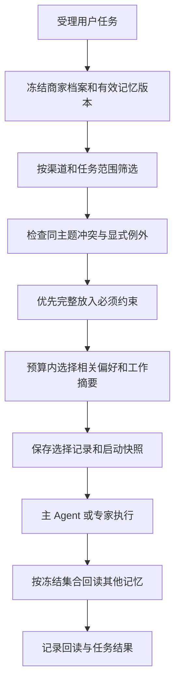

# 织伴商家个性化记忆技术方案 V0.1

日期：2026年11月1日

状态：分阶段实施。已实现的范围见下方说明；其他章节仍为设计目标，不能作为已上线能力。

实施补充：已接入默认 BM25、可选 Embedding 混合召回及本地派生向量缓存；已实现商家/商品归属、可选精确商品版本依据、人工审核门槛（包含短期总结与“记住”）、逐消息归档来源、混合商品总结待分类、旧条目待审核，以及历史记忆工具正文投影过滤。实际配置与调用链以根 README 和源码导航为准。主题唯一键、自动冲突治理、批量审核、必须约束的完整注入和立即撤销、效果反馈提取及独立使用记录尚未实现。第二节保留改造前的基线说明。

### 本轮验收记录（2026-11-01）

- 在独立临时数据目录使用真实 SQLite Worker、Run Plan、上下文组装和工具执行，13 组检查通过：同名商品隔离、未选商品仅通用、跨商家拒绝、审核前后召回、CAS 冲突、改名与依据版本过期、冻结快照、逐消息归档、混合商品总结待分类、幂等完成、停用商品、旧记录兼容和重启持久化。向量接口检查覆盖融合、缓存、服务失败/配置变化回退、取消及预算失败传播。
- 本机 Chrome + 实际 Host 的 7 组检查通过：启动、商品记忆创建与刷新、旧记忆必选归属、HTTP 400/409、普通商家 Run、商品创作及写作专家提交/草稿登记、页面无脚本异常。草稿实际终态为 `READY_FOR_REVIEW`，没有自动审核发布。检查实际 Provider 请求，普通商家会话无商品记忆，商品 A 创作无商品 B 和已失效依据的记忆正文。
- Host/Web TypeScript 检查、Biome 全源码检查、职责注释检查与生产构建通过。构建仍有依赖的 `use client` 指令和大包体提示。
- 模型使用本机 SSE/Embedding Mock，未调用真实云模型；这些结果验证边界、持久状态和接线，不代表真实语义召回率、自然语言遵循率或创作质量提高。没有新增仓库单测。旧助手文字与既有压缩摘要未重写，立即撤销、自动冲突治理等未实施能力仍按设计章节标注。

本方案服务于本机多商家 Agent 工作台，让 Agent 在跨会话创作、返修和研究时，持续遵循商家确认的表达偏好与经营约束。第一阶段复用现有 SQLite、记忆版本、商家快照和 Run 执行链，补齐适用范围、同主题更新、冲突处理和任务召回；第二阶段再接入反馈提取。保持人工确认事实与模型归纳分离。

所有由模型整理或聊天指令产生的待保存内容，包括近期总结，都必须先经过人工审核，才能作为商家记忆供后续任务使用。会话归档、总结生成完成和记忆审核通过是三个不同结果；归档或模型任务成功不能自动代表记忆已经生效。

## 一 设计结论与取舍

当前最需要解决的是“记忆是否仍然适用、不同条目是否互相矛盾、执行时是否读到了正确内容”。现有单条记忆版本校验应继续保留，但它不能解决两条不同 ID 的记忆表达相反要求的问题。

| 设计选择 | 为什么这样做 | 预期好处 | 代价与处理方式 |
| --- | --- | --- | --- |
| 档案、个性化偏好、临时要求和执行记录分别维护 | 四类信息的真实性、生命周期和适用范围不同 | 地址有唯一维护入口，一次返修不会变成永久规则 | 需要清楚的路由规则，前端用业务名称呈现，避免用户理解技术分层 |
| 同主题同范围更新同一条记忆 | 新建 ID 再多也无法自动说明谁替代谁 | 减少旧偏好和新偏好同时生效 | 主题归类可能出错；Host 控制主题键，语义不明确时由用户选定 |
| 模型整理为待审核内容，用户决定生效 | 原话真实不代表提取含义与适用范围正确，近期总结也可能失真 | 降低错误内容跨会话传播的概率 | 增加审核操作；集中展示待审核内容，不逐条打断创作 |
| 重要约束完整注入，其他记忆按任务选择 | 最近创建的几条不一定最重要 | 降低漏掉禁忌的概率，控制上下文占用 | 需要处理预算不足和漏召回；完整约束超预算时明确报错 |
| 每轮冻结，下一轮读取新版 | 同一轮执行中混入多个版本会使结果难以解释 | 主 Agent 与专家可复现同一执行依据 | 新偏好不会自动改写正在生成的内容；页面明确生效范围 |
| 记录提供、回读与排除原因 | 输入中出现过记忆，不等于模型一定遵守了它 | 支持定位“没召回”和“召回后没遵守” | 增加少量持久记录；仅存引用、选择原因和必要诊断信息 |

这些收益是设计目标，需通过后文场景验收确认，不能视为已经测得的效果。

## 二 当前实现与问题

### 当前已有能力

当前实现可以人工新建与编辑记忆；商家会话中完整匹配“记住：……”的消息会直接存为长期规则；归档会话产生近期总结和待确认的长期候选。长期候选确认后才进入新任务的有效记忆集合。

当前近期总结会自动写成 `SHORT / ACTIVE`，聊天“记住：……”也会直接写成 `LONG / ACTIVE`。这两条路径不满足本方案新增的人工审核要求，需要在第一阶段一并调整。

`merchant_memory` 保存条目当前版本，`merchant_memory_revision` 保存不可变正文和哈希。编辑使用 `expectedRevision` 防止旧页面覆盖新版。消息受理时，Host 冻结有效记忆的 ID、版本和哈希，Agent 只能回读这轮获准的集合。研究子专家的任务内笔记另有版本管理，不属于商家长期记忆。

当前行为的主要源码位置如下：

| 位置 | 当前职责 |
| --- | --- |
| [memory-store.ts](./src/host/modules/merchants/infrastructure/memory-store.ts) | 人工记忆、明确记住、版本校验、归档来源、总结和候选提交 |
| [memory-service.ts](./src/host/modules/merchants/application/memory-service.ts) | 独立总结任务、模型调用、格式纠正和失败处理 |
| [db-worker.ts](./src/host/infrastructure/sqlite/db-worker.ts) | 事务、消息受理时冻结商家记忆、来源及归属检查 |
| [context-assembler.ts](./src/host/runtime/context/context-assembler.ts) | 将冻结记忆装配到模型输入 |
| [tool-catalog.ts](./src/host/runtime/tools/tool-catalog.ts) | 冻结集合的记忆检索与分段回读 |
| [memory-panel.tsx](./src/renderer/features/merchants/memory-panel.tsx) | 人工维护、候选确认、版本历史与归档任务回执 |
| [task-context.ts](./src/host/runtime/context/task-context.ts) | 本篇要求的增量、替代关系和版本检查，可复用其业务思路 |

### 需要修正的行为

| 问题 | 当前表现 | 对商家体验的影响 |
| --- | --- | --- |
| 缺少同主题替代 | “活泼俏皮”和“克制专业”可作为两个 ID 同时有效 | 用户已纠正，后续仍可能出现旧风格 |
| 缺少结构化范围 | 只有类型与过期时间，没有渠道和任务范围 | 一篇内容的意见可能影响其他内容 |
| 采集入口有限 | 主要依赖人工维护、明确前缀和归档 | 多次返修中的稳定偏好难以积累 |
| 默认召回依赖创建顺序 | 默认放入最近创建的五条长期记忆和五条近期总结 | 旧但重要的要求可能未进入默认输入；编辑旧条目也不改变创建顺序 |
| 检索主要依赖字面 | 中文相邻双字和字符串匹配，最多返回十条 | 表达变化可能漏召回，命中不一定代表业务相关 |
| 摘要与偏好混用风险 | 近期总结作为活动记忆，默认三十天有效 | 过去的建议、进度可能被误当成当前偏好 |
| 总结存在多次裁剪 | 来源最多八十条、总计一万八千字，单条最多三千字；写入近期记忆时再次截前两千字 | 后续记忆读取不一定覆盖完整归档结果；归档任务仍保留完整结果 |
| 容量竞争 | 有效候选、长期条目与近期总结共用一百条限额 | 大量待确认候选可能阻止新总结事务完成 |
| 审核范围不完整 | 长期候选需要确认，但近期总结和聊天明确记住可直接生效 | 模型整理或含糊的聊天内容可能未经核对进入后续任务 |

数据库版本保护已存在。这里的重点是内容层面的更新、范围和适用性，不应据此认定当前数据库会任意覆盖记忆。

## 三 信息归属与生效规则

### 四类信息的归属

| 信息类别 | 维护位置 | 生效规则 |
| --- | --- | --- |
| 人工确认的客观事实 | 现有商家档案、商品和服务资料 | 档案为权威入口；记忆提取不能自动改写档案 |
| 稳定偏好与经营约束 | 商家长期记忆 | 用户明确保存或确认后跨会话使用 |
| 临时活动决定和单篇要求 | 本篇 TaskContext，或带活动和期限的记忆 | 只在明确范围内使用，不默认推广为商家全局规则 |
| 调研过程、任务状态与实际成果 | 现有研究笔记、Job、Run、Artifact 和业务回执 | 由实际记录判断状态；总结只能作为导航和背景 |

保留当前 `FACT`、`DECISION`、`PROGRESS` 等类型以兼容历史数据。新增录入时，引导客观事实回到档案，进展回到工作记录。历史 FACT 不自动变成档案字段，也不因迁移而提升可信度。

### 优先关系

Host 的授权、归属、工具权限和外部成功回执始终独立校验。任何记忆内容都不能扩大权限。

在获准业务范围内，普通偏好作为默认值：当前任务明确要求优先；存在显式例外关系时使用例外。用户确认的必须遵循约束与当前要求发生冲突时，展示冲突并取得具体选择，不能靠模型自行判断可以忽略约束。

客观事实与文风偏好不采用同一套覆盖规则。“这次写成周日营业”不能自动修改档案中的营业时间。发现冲突时应核对事实或提示更正档案。

## 四 记忆数据结构

### 扩展现有记忆契约

保留现有 ID、版本、状态、来源和哈希，在新版正文中增加以下字段。以下名称为拟议契约，实施时同步调整共享类型和 Schema。

| 字段 | 含义与规则 |
| --- | --- |
| `formatVersion` | 新格式版本，避免对历史正文作无依据解释 |
| `topicKey` | 可维护的主题键，如 `copy.tone`、`copy.emoji`、`image.style` |
| `subject` | 记忆作用对象：商家通用，或绑定当前商家商品目录的 `PRODUCT` 条目 ID；不使用商品名称作关联键 |
| `productBasis` | 可选的商品版本依据，引用 `entryId`、`revision`、`sha256`；仅依赖特定商品资料版本的记忆填写 |
| `scope` | 由渠道、任务类型和活动 ID 组成的条件；条件同时满足才适用 |
| `strength` | `DEFAULT` 为默认偏好；`REQUIRED` 为用户确认必须遵循的约束 |
| `pinned` | 用户指定重要，影响同类候选排序，不扩大适用范围 |
| `validFrom` | 生效时间；第一阶段取确认时刻，与现有 `expiresAt` 一起表示有效区间 |
| `changeSource` | 当前修订的原话、来源版本、操作者和确认时间；原始来源仍保留 |
| `proposal` | 仅候选使用，记录建议新增或更新、目标 ID 和预期目标版本 |
| `resolution` | 候选确认或忽略的结果，记录最后写入的条目和版本 |
| `overrideOf` | 不同范围的显式例外引用，绑定被例外的条目及版本 |

第一阶段的范围条件仅使用结构化渠道、任务类型和可验证的活动 ID。单篇例外保存在 TaskContext，不再建立一份跨商家会话的临时记忆。未建立正式活动实体时，不接受模型自由生成活动 ID，可使用明确有效期或保留为任务要求。第一阶段不提供预约生效；未来才需要执行的偏好保持候选，不提前覆盖当前规则。

主题键由 Host 管理预设词表。允许用户建立自定义主题；自定义主题使用 Host 分配的稳定 ID，模型只能提出归类建议。一个主题表达一个可独立更新的偏好，避免用“品牌风格”存放十项互不相同的规则。

### 同主题更新和范围例外

同一商家、同一作用对象、同一主题、同一规范化范围，只允许一个已生效的长期条目。新的内容直接形成该条目的下一版，历史版本继续保留；A 商品与 B 商品的同主题记忆不能互相替代。

例如“小红书文案语气”从“活泼俏皮”变为“克制专业”，应更新原 ID 的版本，而不是新建另一条并列有效记录。

全渠道默认语气与小红书语气可以同时存在。更窄范围只有在用户明确建立例外后才覆盖默认偏好。两个范围互有交集、却不能互相包含时，不能只靠“字段更多”决定胜负，应展示冲突。`REQUIRED` 的例外也必须由用户明确决定。

第一阶段只确定结构化范围重叠和同主题冲突。不同主题中藏着的语义矛盾仍可能漏检，模型提示只能作为辅助，不能承诺全部识别。

### 商品绑定与任务范围

本节属于待实施的商品记忆改造。当前记忆只绑定 `merchantId`；已经实现的 BM25 和可选向量召回没有结构化商品过滤。商品创作链则已有可复用的选择与版本依据：[text-generation-store.ts](./src/host/modules/publication/infrastructure/text-generation-store.ts) 校验 `productEntryId` 属于本商家的活动商品，生成 `ProductContentSnapshot`，返修沿用原商品版本。新增记忆绑定应连接这条来源链，不再维护第二套商品或根据名称猜 ID。

记忆对象使用以下两种形式；范围条件仍单独表达渠道、任务类型与活动，避免把商品、渠道和主题混成一个字段：

```ts
type MemorySubject =
  | { kind: "MERCHANT" }
  | { kind: "PRODUCT"; productEntryId: string };

type MemoryProductBasis = {
  entryId: string;
  revision: number;
  sha256: string;
};
```

保存或审核商品记忆时，Worker 必须校验条目属于当前商家、`kind=PRODUCT` 且仍活动。商品名称仅作展示，不参与身份关联。`productBasis` 如果存在，必须与相同 `subject` 的真实商品历史版本匹配。候选更新目标也必须属于相同作用对象，不能用商品反馈直接覆盖商家通用偏好。

**任务商品的取得与冻结。** 图文任务从已经受理的 Job 及其 `source.product` 取得目标，返修从原稿来源继承；Host 在受理事务中复核并冻结 `entryId`、版本和哈希。主 Agent、专家、图片步骤和续执行沿用这份来源，不能在委派启动时改成最新商品或换另一款。普通商家聊天若没有结构化目标，第一阶段只使用商家通用记忆；需要商品记忆时，先由用户通过商品选择入口确定目标，再受理新一轮。模型可以建议匹配对象，不能凭搜索参数扩大本轮已冻结的商品范围。

第一阶段按现有任务的一次单商品模型落地。多商品对比、组合套餐和商品组不自动取所有商品记忆的并集，后续需要按商品分别装配并明确各自规则；选择不明确时保留任务要求并询问，不把某款的要求提升为全商家规则。

**先确定适用集合，再做相关性排序。** 在消息受理的商家记忆快照中，只纳入人工审核通过且状态、有效期、渠道等条件满足的记忆；指定 A 商品时，集合为“商家通用记忆与 A 商品记忆”。不指定商品时，集合只有商家通用记忆。B 商品记忆不进入 A 任务的默认输入、搜索、分段回读、向量请求或专家上下文。BM25 的语料统计和向量相似度计算都在过滤后的集合中完成，不能先对全商家排序再补一个显示过滤。

需要同时覆盖以下入口：`createMerchantContextSnapshot` 的 `memoryRefs`、`assembleMerchantContext` 的 `coreRules` 和 `recentWork`、`merchant_memory_search`、`merchant_memory_get`、专家上下文，以及完整归档总结的受控回读。即使模型知道其他商品的记忆 ID，回读也必须拒绝。商家商品目录本身的读取授权维持原规则；“商品资料可读”和“商品偏好适用于本任务”是不同判断。

**归档提取按每条来源判断对象。** 同一商家会话可能先后讨论 A、B 两款商品，不能把整段会话都归到最后一款商品。冻结归档来源时，给每条用户消息或返修意见附上 Host 可核验的任务商品引用；已有 `message → Run → generation_job → source.product` 来源关系可以用于追踪。不能追溯到唯一对象的“这款”“那个套餐”进入待澄清。模型只建议商品归属，用户审核时显示商品名称及具体原话，并可以修改或拒绝。

近期总结也遵守商品范围。含多款商品的总结应拆成可分别审核的商家通用部分和各商品部分；无法可靠拆分时，保留在原会话工作记录中，不直接作为所有商品都可召回的近期记忆。批准一个商品摘要，不代表批准读取包含其他商品内容的整份总结。

**商品资料变化与历史输入。** 商品改名仍使用稳定的 `entryId`，无须重新关联。独立于规格和价格的表达偏好可以继续有效；价格、参数等事实仍从商品档案读取。依赖特定商品定位、规格或活动条件的记忆填写 `productBasis`，与任务采用的商品版本不匹配时标记待复核并排除默认召回，由用户确认后产生新版。商品停用后不再为新任务启用专属记忆；旧版本保留作来源审计，不能借重建任务悄悄恢复已停用对象。

同一普通会话切换商品时，还要处理旧上下文中的记忆工具结果：可识别的旧商品记忆正文应在请求投影中排除，压缩后重新注入本轮适用集合，并保留原始历史文件。用户原话仍是历史资料，不能删除或改造成新的品牌规则；摘要必须保留商品归属，不能把 A 商品偏好压缩成无对象的通用指令。正式商品创作优先复用现有独立任务历史。仅过滤搜索结果不能保证历史对话中的规则不会被误用，这部分需要跨商品续聊验收。

**迁移与缓存。** 无 `subject` 的旧记忆显示为未整理，审核时确认商家通用或指定商品；不能把所有旧条目默认判为通用，因为正文可能已有商品限定。保留旧正文、哈希和快照，新的有效集合采用新版策略。已冻结旧范围的任务不在运行中扩权，必要时按用户确认的新范围创建续执行。

本地向量缓存不需要按商品复制一套数据库：先按任务范围取得获准记忆，再按现有记忆 ID、版本和哈希回读缓存即可。修改商品归属属于修改记忆正文，需要新版及重新审核；本轮已经冻结的缓存引用不改变。即使以后换成 pgvector，商品范围校验仍由 Host 负责。

**实施顺序和验收。** 先接通目标商品冻结与记忆字段，再完成审核页的对象选择；随后同时收紧默认注入、搜索、回读、归档和专家链路，最后核验商品修订与历史兼容。第一批场景应包含：A/B 同名但不同 ID、商品改名、未选商品、跨商家商品 ID、同一会话切换 A/B、跨商品旧工具结果、商品停用、旧稿返修、带版本依据的记忆过期，以及向量请求不得包含 B 商品专属记忆。以上为验收要求，尚未实施或执行。

### SQLite 落点

继续使用现有两张记忆表，增加以下当前状态字段：

- `merchant_memory.active_slot_key`：仅新版已确认、长期且状态为 `ACTIVE` 的条目占用，由 Host 根据作用对象、主题和规范化范围计算。过期条目仍保留主题归属，后续同主题优先更新原 ID；显式停用时释放槽位。
- 唯一索引 `(merchant_id, active_slot_key)`：SQLite 允许多个空值，候选、近期总结和停用条目不占用槽位。
- `merchant_memory.revoked_through_revision`：记录用户明确立即撤销到哪一版，用于阻止仍引用旧版的后续外发。

新增 `merchant_memory_state`，保存商家已发布记忆的集合版本 `publishedRevision`。确认、编辑、停用、立即撤销等影响发布内容的操作在原事务中推进它；候选生成不推进。该版本用于快照说明和变化检测，不要求所有互不相关的编辑都互相冲突。

新增 `merchant_memory_review`，记录被审核条目的 ID、精确版本与正文哈希、审核决定、操作者、时间和操作键。审批结果只适用于被确认的具体正文；之后修改正文、范围或强度必须形成新版本并由人工再次确认。人工表单的“保存并生效”可以在一次提交内完成版本保存与审核回执，不增加重复弹窗。模型调用和后台任务无权生成通过审核的记录。

到期是基于时间计算的状态，不要求后台定时写库才能生效。快照同时保存 `capturedAt`；执行前的即时撤销检查还应检查相关必须约束是否已到期，不能只比较集合版本。

新增 `run_memory_manifest`，按 Run、Attempt、执行角色和正文哈希保存不可变的记忆选择记录。具体字段见第六节。第二阶段单独增加 `memory_candidate_job`，避免把新的反馈提取状态混入现有归档任务契约。

`body_json` 仍是版本正文依据，新增索引列只是投影。当前版本指针、索引列、集合版本、幂等回执和业务事件必须在同一个 Worker 事务内更新，禁止拆成多次跨 Worker 请求。唯一约束只覆盖新版已整理的条目；历史内容尚未归类时仍可能与新条目重复，应提示逐步整理，不能宣称迁移后全库已经消除语义重复。

## 五 写入与冲突处理

### 三类写入入口

人工维护页可以直接保存已确认偏好，同时填写主题、范围和有效期。同主题同范围已存在时，界面先显示更新对象和差异。

“记住：……”代表持久保存意愿，统一生成待审核卡片，不直接成为有效记忆。即使模型认为内容没有歧义，也需由用户核对正文、主题、范围和替代对象后确认。本轮原始要求继续按现有输入处理，不因候选未确认而丢失。

归档总结、长期偏好提取和后续反馈提取只能创建待审核内容。近期总结与长期偏好可以分项审核；确认某条长期偏好不等于认可整份总结，确认总结也不自动认可其中的长期候选。确认卡片显示原话、拟保存内容、适用范围、有效期和将被更新的旧内容，支持“新增”“更新旧偏好”“仅用于本次”“忽略”。

流程为“生成完成 → 待审核 → 用户通过、编辑后通过或拒绝 → 通过的具体版本进入后续任务”。允许持久化待审核草稿用于页面展示、审计和恢复，但不得把它加入商家记忆快照、默认上下文或记忆检索工具。未审核和被拒绝的内容不会因超时、重试或重启自动获批。

### 确认候选的事务

一次确认携带候选 ID、候选版本、确认后的字段、目标 ID、目标预期版本和幂等键。Host 执行以下顺序：

1. 验证配对用户、活动商家、候选归属、候选状态和版本；核验来源可用及原话范围。
2. 验证主题、范围、有效期及例外引用。目标条目必须属于同一商家。
3. 更新旧偏好时，核验目标 ID 与预期版本，并验证主题和范围没有被模型偷偷改变。
4. 新增时检查活动槽位；已有条目则返回冲突，不能自动再建第二条。
5. 追加目标新版本、当前修订来源和绑定最终正文哈希的人工审核回执，更新索引列和发布集合版本；候选追加为已处理的停用版本，并记录最终目标引用。
6. 同事务写入事件与幂等结果后，才返回保存成功。任一步失败全部回滚。

“仅用于本次”走现有任务要求增量流程，携带用户选择的目标 TaskContext 与预期版本，保存具体原话和例外来源，不推进商家发布集合。归档来源不自动成为目标任务；没有可写的目标时，先选择任务或保留候选。正在执行的冻结输入不原地改写，按原任务追加输入和取消、续执行规则处理。

两个页面确认同一候选，只允许第一次改变状态。两个不同候选更新同一主题时，第二次应因目标版本或活动槽位变化而失败，并展示最新差异。不能用“换一个幂等键再试”绕过版本冲突。

模型提取时看到的版本只能用于提出建议。确认前必须重新核验；自动重新归类到另一个主题或范围不属于安全重试。

### 状态和恢复

复用现有 `CANDIDATE`、`ACTIVE`、`INACTIVE`。候选确认更新已有条目后自身转 `INACTIVE`，通过 `resolution` 区分已合并和已忽略；当前 UI 需要显示这种区别。

近期总结也先处于 `CANDIDATE`。Host 只允许“活动状态、有效时间、精确版本审核通过”同时满足的内容进入新任务。模型任务的 `SUCCEEDED` 仅说明生成完成，页面文案为“整理完成，待审核”，不显示“记忆已归档生效”。待审核数量可以汇总，但每项独立的审核回执才是生效依据；批量通过也必须绑定用户实际选中的具体版本。

停用不物理删除历史。误确认后的撤销产生新版本，不倒退版本号。恢复旧内容时再次核验活动槽位、范围和有效期，避免把旧冲突一起恢复。

## 六 任务召回和实际应用

### 冻结可读集合与选择输入

沿用消息受理时冻结记忆版本的行为，并在冻结前过滤未经人工审核的内容。新版快照额外记录审核回执引用、发布集合版本、捕获时间、适用任务信息和策略版本。执行时只能从冻结集合选择，不查询其他商家或悄悄切换到最新内容。



渠道和任务类型优先取 Host 已验证的业务任务字段。普通聊天无法确定时，不把猜测当作范围事实：只自动应用明确适用的全局内容；如果不明确的范围关系影响必须约束，先询问用户。

### 第一阶段的确定性选择

先过滤状态、时间和范围，再解析同主题关系。所有匹配且无冲突的 `REQUIRED` 内容必须完整加入任务约束；其余依次考虑已确认的范围例外、用户置顶、任务相关性和最近确认时间。

优先按结构化主题匹配任务，再进行相关内容检索。检索缺省采用本地 BM25；向量模型完整配置后增加语义召回，使用 RRF 合并两路排名。检索服务异常回退 BM25，不要求本机部署 Embedding 模型或向量数据库。主题、范围和详细选择原因属于后续治理改造，不能当作本次检索已具备的功能。

记忆输入建议上限为两千个估算 token，并受当前模型真实剩余预算限制。这是待验收的初始参数。必须约束不能因达到条数或预算上限而截断；放不下时返回 `MEMORY_CONTEXT_BUDGET_EXCEEDED`，提示精简或缩小范围。普通偏好可退到可回读索引，并明确哪些未进入默认输入。

近期总结经过人工审核后仍保持“模型归纳”标识，不进入必须约束，也不能因审核通过就自动转成已确认事实。关键业务状态始终回查原 Job、Artifact 或回执。

### 记忆选择记录

每份 `run_memory_manifest` 至少保存：

- Run、Attempt、角色、商家快照引用、发布集合版本和捕获时间。
- 召回策略版本、任务范围、任务要求摘要哈希，以及父记录引用。
- 自动提供的条目 ID、版本、哈希和选择原因；因冲突、范围不符或预算而排除的原因。
- 进入默认输入的完整约束与偏好引用，以及最终正文哈希和 token 估算。

Agent 主动回读另记事件，绑定原 ID、版本和哈希。页面分别显示“已提供”“已回读”“未选择”，不使用“模型已遵守”这种无法由输入记录证明的表述。是否遵守，应通过内容审查和人工反馈判断。

记忆属于冻结执行依据。更新了必须约束或用户例外时，同步纳入现有任务要求投影和摘要，使用原文及版本引用；检索到的普通背景不能伪装成用户新指令。上下文压缩后必须能重新注入相同的冻结约束，不依赖压缩摘要记住全部规则。

### 主 Agent 与专家一致性

专家沿用父 Run 的商家快照、策略版本与已解析约束。允许按职责减少无关普通偏好，但不允许遗漏适用的必须约束。子记录明确引用父记录，不能在委派启动时重新抓取商家最新记忆。

研究任务内笔记继续由现有研究记忆链维护，不能自动写入商家长期记忆。正式专家提交和后续后台研究续执行都需要保留原任务的版本来源，不能借自动续执行切换用户没有确认过的新要求。

## 七 运行中修改和立即撤销

普通编辑默认影响后续受理的任务。本轮结果仍保留冻结版本说明，界面可提示“运行期间商家偏好已更新，本次使用旧版”。这类变化不应自动重试整轮，也不能自动重复图片生成等付费操作。

对必须约束，提供明确的“立即停止使用旧规则”操作。在编辑或停用的同事务中推进 `revoked_through_revision`，标记相关活动 Run 的执行依据已失效，并发出取消意图。

取消本身不能代替执行前检查。图片生成、导出等受影响的关键边界，应复核自身记忆依赖的撤销标记与有效期；过期依据返回 `MEMORY_BASIS_STALE`，等待用户基于新要求继续。已经发出的外部请求可能无法撤回，必须保留真实回执，不能宣称取消成功就没有发生费用或副作用。

只检查本任务实际依赖的记忆，不因某商家新增无关偏好而停止其所有任务。若任务先于更新完成提交，原结果保留，后续交付前仍执行相应检查。

“立即撤销”限制后续执行，不承担删除历史的职责。用户若要求彻底删除资料，应沿项目数据清理流程处理快照、版本、来源和运行文件。

## 八 反馈提取与总结改进

本节属于第二阶段。第一阶段上线不依赖自动提取。

### 提取判定规则

新版规则采用独立版本 `merchant-memory-extract-v2`。提取单位是一项可独立更新的偏好或决定，不是一整段聊天总结。每项都必须能回答“谁表达的、原话是什么、适用于哪里、何时有效、是否与已有内容重复或冲突”。缺少依据时输出不提取或待澄清，允许整个请求返回空候选。

以下规则是拟实施的 V2 契约。当前归档 V1 已要求区分来源角色、引用原话和候选确认，但尚未实现这套范围与更新判定。

| 判定 | 允许条件 | 输出与后续处理 |
| --- | --- | --- |
| 长期偏好候选 `LONG_CANDIDATE` | 用户直接表达稳定习惯、持续约束或明确要求长期记住；原话支持具体主题与拟议范围 | 保存待确认候选，不直接进入有效集合 |
| 限定范围候选 `SCOPED_CANDIDATE` | 用户明确表示某渠道或活动的一段时期持续采用，且范围有依据 | 记录已知范围和期限；缺少必要条件时保持待澄清 |
| 仅本次 `TASK_ONLY` | 出现“这一篇”“本次”“这张图”，或只评价当前成果且未表达持续意图 | 留给原 TaskContext 流程，不创建长期记忆，不由提取模型直接改任务状态 |
| 档案更正建议 `PROFILE_CHANGE` | 用户修改地址、价格、营业时间、产品参数等客观资料 | 展示与当前档案的差异，引导用户确认修改档案，不建立平行事实来源 |
| 待澄清 `NEEDS_CLARIFICATION` | 持续意图、适用范围或新旧关系无法确定 | 显示具体不确定项，不用默认值补成全局长期偏好 |
| 不提取 `IGNORE` | 助手建议、引用素材、假设讨论、客户评价、普通寒暄、孤立赞同或实际成果状态 | 不创建偏好候选；必要的业务记录仍沿原链路保存 |

判定顺序为：核验来源与说话对象，排除引用和假设，分出事实更正与任务状态，再判定是否仅本次，最后判定长期或限定范围候选。明确的“仅本次”优先于“记住”或“必须”等词，不能用几个关键词直接决定记忆类型。

普通返修意见如“太像广告了”默认仅本次；“以后我们的小红书文案都不要这种硬推销语气”可以生成对应范围的候选。内容反复出现可以作为用户复核时的辅助依据，但重复次数本身不能把任务要求升级为长期规则。用户点击“记为偏好”时，新产生的明确保存意愿也应成为来源事件。

### 来源与归纳规则

长期和限定范围候选的依据必须来自获准的用户原始消息、用户返修意见或人工记忆表单。助手回复、已有压缩摘要、研究报告、商家近期总结只可作为理解上下文，不能作为用户偏好的唯一证据。引用其他来源的 user 消息仍需识别内容性质，不能因为外层角色是 user 就把引用内容当作用户立场。

每项候选保留所有必要的来源引用，包括来源 ID、来源文本哈希、任务或会话、原始时间和逐字连续原话。单条原话继续使用现有五百字上限；多条证据分别列出，不拼接成一条伪造引文。Host 按冻结来源核验角色、归属、哈希和原话，模型不能自行补充未提供的来源 ID。

允许删除口头语和把一句话拆成独立偏好，不允许扩大语义。例如“少用表情”不能变成“禁止表情”，“这一篇克制一些”不能变成“品牌一贯克制”。不得从“喜欢米白色”推导目标客群、价格定位或消费能力。数值、否定、程度词、渠道与时间限制必须保留。

这些语义约束需要在确认卡片和质量验收中检查。Host 能核验引文真实，不能仅靠字符串校验证明归纳完全忠实；模型自报置信度不作为自动生效依据。

### 范围与时间规则

渠道和任务类型可以由原话明确指定，也可以来自本任务由用户选定且 Host 已验证的结构化字段。由任务字段补充的范围必须在确认卡片中标注。任务里出现一个小红书链接，不足以证明偏好适用于所有小红书内容；没有渠道信息也不能自动解释为所有渠道。

没有说明持续时间的单次反馈按 `TASK_ONLY` 处理。明确表达长期偏好但范围不清时按 `NEEDS_CLARIFICATION` 处理；不能依靠 `expiresAt=null` 把不确定内容永久保存。

“本周”“本月”等相对时间，按原始来源事件的时间和 Host 记录的任务时区计算，不能按模型执行或重试时间重新计算。确认卡片显示展开后的具体截止时间。来源时间、时区或活动边界无法确认时，保留原表达并要求补全。候选确认时已到期的活动不能继续生效。

“必须”“绝对不要”可以提出 `REQUIRED` 建议，但必须经用户确认其强度与范围。“记住”表达保存意愿，本身不表示所有内容都是永久禁令。提取模型不能创建新的工具授权、付费授权或自动交付权限。

### 重复与冲突规则

模型根据 Host 提供的现有主题与冻结版本，提出新增或更新建议。精确匹配同主题同范围时提出 `UPDATE` 并携带目标 ID 和预期版本；找不到明确对象时不能仅凭相似措辞自动新建并生效。

已经有相同有效偏好的，输出重复依据并在处理记录中关联，默认不再次创建候选。含义是否相同不确定时，保留供用户核对。表达相反内容时提出冲突，确认卡片同时展示旧原话与新原话，用户可以选择更新、限定为本次或调整范围。

更窄范围的不同偏好应提出“是否作为例外”，不能停用全渠道默认偏好。与已忽略或已停用内容相似的提取结果，不得因为重试自动重新激活；出现新的明确用户指令时，可创建引用新来源的候选，并展示原处理历史。

### 输出契约与数量规则

每次结果按条目给出 `decision`、受控的 `reasonCode`、主题建议、原话支持的最小正文、拟议范围、时间依据、来源引用，以及可选的更新对象。`NEEDS_CLARIFICATION` 还需列出待补字段。模型输出中不接受 `ACTIVE` 状态、确认人或确认时间。

普通提取请求默认最多生成五项候选，沿用现有归档候选数量上限作为初始值；该值在 V2 中是独立配置。按明确持续意图、反馈相关性和证据完整程度选择，不能为了凑够五项生成内容。若还有未处理的重要事项，返回覆盖范围及截取标记，不宣称已经提取全部偏好。

格式或来源不合法时，可在同一 Attempt 内最多纠正一次，沿用当前总结的有限纠正思路。越权来源拒绝提交；语义或范围不确定进入待澄清，不能反复提示模型直到它猜出一个确定答案。人工确认仍按第五节重新核验当前版本和来源。

### 提取正反例

| 用户表达或上下文 | 应得到的结果 | 不能得到的结果 |
| --- | --- | --- |
| “以后我们的小红书文案都少用表情，保持专业” | 两项待确认偏好，分别描述表情使用和语气，范围为小红书文案 | 全渠道禁止使用表情，或自动归入永久必须约束 |
| “这一篇太像广告了，改成分享体验” | 仅本篇要求 | 品牌永久禁止营销内容 |
| “我们品牌所有内容都不能写治愈疾病” | 必须约束建议，确认具体范围后生效 | 直接授予模型判断所有医疗内容合规的权限 |
| “客户评论说喜欢夸张标题” | 不提取用户偏好，评论仍可作为分析材料 | 商家偏好夸张标题 |
| 助手说“建议以后都用米白色” | 不提取用户偏好 | 已确认视觉规范 |
| 用户只回复“好的”，前文同时含三个建议 | 不推断逐项接受，不自动创建三个偏好 | 三个建议全部长期生效 |
| “记住，这次活动只用红色” | 活动范围明确时生成限定候选，否则要求澄清；当前任务原要求保留 | 品牌永久只用红色 |
| 旧偏好活泼，新消息说“以后小红书改成克制专业” | 同范围明确时提出更新旧偏好，确认前展示新旧内容 | 新旧两条同时有效 |
| “我们周日改成营业了” | 档案更正建议，需要核对生效时间 | 用长期偏好覆盖营业时间档案 |
| 助手称“图片已发布”，但只有下载 ZIP 回执 | 不提取发布成功事实，查询真实业务记录 | 保存已发布或经营效果良好的记忆 |

### 反馈候选任务

由用户显式点击“提取偏好”，或在商家设置中开启反馈候选提取。自动触发点限定为持久化的用户纠正或返修事件，不对每条消息启动模型请求，也不把“没有反对”当作喜好。

`memory_candidate_job` 保存商家和原会话、触发消息或返修事件、冻结原话及哈希、允许提供的上下文、已有主题和目标版本、模型及提示词版本、预算与真实用量、状态、Attempt、失败原因和结果引用。

来源只使用该商家获准的会话文字和返修意见。原素材或附件需要额外授权时继续按原规则处理。提取模型没有业务执行工具，只能输出候选及建议更新目标。

任务键由商家、来源事件、来源哈希和提取规则版本确定；同来源同规则重试不重复产生候选。跨来源相似内容可以标注疑似重复，但只有经过确认才能合并，不能仅凭文本相似度删掉差异。

调度复用现有 MemoryService 的单任务思想，可在同一服务内增加独立队列；先保障已有归档任务。提取使用单独、可配置的次数与 token 额度，冻结每次尝试配置并结算真实或未知用量，不重新打开已经结束的主 Run 来借用额度。

处理中断后最多自动恢复一次，之后显式重试。无模型配置、超过预算、来源撤回或商家停用时记录真实状态；失败不改变主任务成功状态。旧 Attempt 的结果不能提交到新的候选任务。

### 完整摘要与容量

归档完整结果继续保存在原任务中，生成完成后只作为待审核草稿显示。近期记忆在审核通过后才作为有明确范围的摘要入口，显式说明截取情况，不再将截断片段冒充完整工作记录。用户归档会话或允许模型生成总结，不等于批准其进入后续商家任务。

需要回读完整总结时，扩展新版 `merchant_memory_get` 的受控详情模式：以冻结条目关联的归档结果引用、结果哈希和人工批准的具体内容范围为依据，分段返回获批结果及类型标签。只批准摘要不等于批准未审核的完整总结，编辑后通过的摘要也不能作为读取原始草稿的通行证。不能仅凭模型提供的 jobId 查询任意总结。历史接口继续返回原有条目正文。

长期生效条目、待确认候选和近期总结分开计算限额。初始沿用一百条作为长期生效条目容量参考，其他限额配置化后通过验收确定。候选满额应标记待整理，不得自动淘汰必须约束；也不应导致已经完成的总结整体回滚丢失。将“保存完整总结结果”和“转成候选或近期入口”的处理结果分别记录，确保可重试且不重复写入。

## 九 接口与错误语义

| 接口 | 拟议变化 |
| --- | --- |
| `GET /api/v1/merchants/:merchantId/memories` | 返回主题、范围、强度、当前版本及候选处理结果；支持业务分类筛选 |
| `POST /api/v1/merchants/:merchantId/memories` | 扩展人工新建字段；命中已有活动槽位时返回更新对象 |
| `PUT /api/v1/merchants/:merchantId/memories/:memoryId` | 保留预期版本和幂等键；增加当前修订来源与立即撤销选项 |
| `POST /api/v1/merchants/:merchantId/memories/:memoryId/resolve` | 明确处理候选，携带新增、更新、仅本次或忽略选择及目标预期版本 |
| `GET /api/v1/sessions/:sessionId/runs/:runId/memory-manifests` | 在现有会话归属检查后查看记忆选择记录与回读事件 |
| 第二阶段反馈提取入口 | 从已有会话或返修实体创建候选任务；完整路由在接入具体业务入口时确定 |

写接口沿用同源、配对、CSRF、幂等和 Worker 事务机制。普通 Agent 继续只有记忆读取能力。新增来源驱动的候选任务不等于授予模型长期记忆写权限。

除输入无效和权限错误外，主要新增或复用以下错误：

| 错误 | 页面行为 |
| --- | --- |
| `MEMORY_REVISION_CONFLICT` | 展示最新内容和用户待保存内容，重新核对，不静默覆盖 |
| `MEMORY_TOPIC_CONFLICT` | 展示已存在主题和适用范围，选择更新或调整范围 |
| `MEMORY_SCOPE_UNRESOLVED` | 补全适用范围，当前任务原始要求继续保留 |
| `MEMORY_CONTEXT_BUDGET_EXCEEDED` | 说明必须约束无法完整放入，要求精简或缩小任务范围 |
| `MEMORY_BASIS_STALE` | 保留现有结果，停止依赖旧依据的新动作，提供按新版继续入口 |
| `MEMORY_SOURCE_INVALID` | 不创建有效记忆，展示具体来源问题 |

版本和主题竞争返回 409。未配置模型、任务预算耗尽、格式失败分别映射到现有或相应的新业务错误，不能统一展示成“已记住”。

## 十 页面交互

商家记忆页按“品牌偏好”“必须遵循”“活动决定”“待确认”“工作记录”呈现。用户看到渠道、适用任务、有效期和来源，无需看到主题槽位、集合版本等实现字段。

确认卡片以旧内容、新内容、适用范围和影响说明为核心。一次性要求优先显示“仅用于本次”；更新规则明确显示“替换哪条旧偏好”。不在每次生成前增加统一确认步骤。

任务详情提供折叠的“本次参考的商家记忆”，显示具体内容、提供或回读状态，以及运行期间发生的版本变化。允许用户指出“不适用于本次”，该操作写入任务例外；选择修改长期偏好时再进入持久更新流程。

保存回执区分“已创建候选”“已确认长期生效”“本次任务已采用”和“后续任务生效”。网络请求受理成功不能显示为模型已经学会或一定遵循。

归档区域分别显示“会话已归档”“总结生成中或整理完成”“待审核、部分通过、已通过或已拒绝”。审核卡片支持查看原话、编辑、逐项或选中批量通过、拒绝和稍后处理。关闭卡片不视为通过，不默认勾选全部内容，也不因模型置信度高而跳过审核。

## 十一 代码改动与兼容迁移

| 层与位置 | 实施职责 |
| --- | --- |
| `src/shared/contracts.ts` 及必要的新共享契约 | 新版记忆、范围、候选解决命令和选择记录；只有契约足够独立时再拆文件 |
| `modules/merchants` | 主题与范围规则、记忆确认、召回选择；按纯规则、应用协调和存储职责适度组织 |
| `memory-store.ts`、`db-worker.ts`、`db-client.ts` | 原子更新、唯一槽位、发布版本、立即撤销和选择记录持久化 |
| `context-assembler.ts`、`runtime-plan.ts`、`prompt-assembly.ts` | 新版快照、策略和精确来源引用，使启动预览与真实输入同源 |
| `tool-catalog.ts`、`delegation-service.ts`、Pi 适配器 | 冻结检索、详情回读、主子一致、压缩后的约束注入和工具边界检查 |
| 图文、图片和导出应用入口 | 仅在相关依赖存在时核验记忆依据，保留原产物版本、费用确认和真实回执校验 |
| `http/server.ts`、API 客户端、`memory-panel.tsx` | 扩展接口、处理 409、确认差异和展示真实回执 |

当前工作区含已有未提交改动，实施应在其现状上做范围明确的补充，避免覆盖研究专家、运行预算等相关修改。

数据库迁移使用实施时下一个可用编号，不预占固定版本。升级前备份数据目录，在独立数据目录验收。迁移规则如下：

1. 不修改旧 `body_json`、旧 SHA 或 Runtime Plan。历史快照必须继续通过原校验。
2. 历史条目按旧语义投影，不自动指定主题、设为必须约束或归入新活动槽位。页面标记可整理范围，不能悄悄改变旧内容的权重。
3. 用户整理旧条目时追加新版正文。同主题旧条目需要显式合并或停用，不能按文本相似度批量删除。
4. 新执行计划、Adapter 和工具契约按实际输入变化推进版本，并保留旧版解析和恢复分支。新增选择记录通过独立引用接入，不向旧计划补字段改变哈希。
5. 归档、回收站、会话清理、商家清理同步覆盖新的来源引用与表，保持原保留策略，不制造无法解释的悬挂引用。
6. 支持在新版程序关闭新策略回到兼容读取；降级运行旧程序不属于无损回滚，需使用升级前备份并核对运行文件。

人工审核是新版固定的生效门槛，不能通过关闭召回优化来绕过。旧版活动总结、聊天直接记住等条目，只有能够由原人工保存或确认回执证明已审核的具体版本，才可建立兼容审核记录；无审核依据的内容进入待审核投影，不改写其历史正文或哈希。旧快照保留作审计；已冻结未审核内容的旧任务，在升级后恢复或继续外发前必须补审，并以新的执行依据续执行，不能沿恢复分支绕过审核。

实施涉及代码时，再同步更新根 README 的实际运行行为和 `src/README.md` 调用链，不把本文计划列入“已实现”。

## 十二 实施阶段与验收

### 第一阶段 完成人工可控的记忆闭环

首先完成所有记忆入口的人工审核门槛，包括近期总结和聊天“记住：……”，再完成主题、范围、同主题更新、候选处理事务、确定性召回和选择记录。保留归档提取入口，明确近期总结的来源与截取状态。接通必须约束依赖和立即撤销检查后，才开放 `REQUIRED` 与即时撤销选项；不做只有页面开关而无 Host 校验的半成品。

这个阶段不需要新增提取模型请求，能先验证用户是否可以稳定维护少量关键偏好，以及跨会话执行是否使用正确版本。

### 第二阶段 减少人工整理成本

接入返修反馈候选、独立预算、幂等队列、完整总结回读和容量分离。候选允许用户集中处理，主任务不等待普通候选提取完成。

### 第三阶段 按实际样例优化召回

收集用户明确指出的漏召回、误用和未遵守案例，区分范围判断、选择策略和模型执行问题。根据样例调整已接入的 BM25、向量相似度初始过滤线与融合排序，不把向量相似当作事实核验。后续迁移到 PostgreSQL 加 pgvector 时，仍必须限制商家和冻结版本，索引结果不能作为权限依据。

### 必须通过的场景

| 场景 | 验收结果 |
| --- | --- |
| 商家 A 与 B 使用相反风格 | A 的记忆在 B 的快照、工具回读和专家输入中均不可见 |
| 小红书偏好与全渠道默认不同 | 有显式例外时只覆盖匹配范围；不明冲突可见 |
| 用户只说“这一篇不要表情” | 本篇要求生效，不自动产生已确认长期约束 |
| 同主题从活泼改成专业 | 新任务只使用新版；历史任务仍能回读原版本 |
| 两个页面修改同条记忆 | 仅一次成功，另一次返回 409，草稿与差异可恢复 |
| 两个候选并发建立同一主题 | 活动槽位只有一个，第二个进入冲突处理 |
| 用户确认后网络断开并重试 | 幂等返回同一结果，不增加修订或重复事件 |
| 总结已生成，但用户未审核 | 仅在待审核页面和来源任务中可见，新任务快照与记忆工具不可读 |
| 聊天输入“记住：……” | 生成待审核卡片，本轮原始要求保留，不自动跨会话生效 |
| 用户只通过两项候选 | 仅所选精确版本生效，其余不自动通过 |
| 用户拒绝或关闭审核卡片 | 拒绝或待处理状态保持，重试、重启不自动激活 |
| 用户编辑后审核摘要 | 只读取获批正文，不能借其来源引用回读未获批的原始总结 |
| 排队期间偏好变化 | 按受理时版本执行并清楚展示，不混用最新记忆 |
| 执行期间立即撤销关键约束 | 后续相关外发被拦截，已发生请求按实际回执展示 |
| 外部图片请求已发出后取消 | 保留请求标识与最终或未知状态，不伪报未收费 |
| 主 Agent 委派写作或视觉专家 | 来源可追到父记录，适用的必须约束一致 |
| 压缩后继续推理 | 同一冻结约束可完整重建，不依赖摘要自行保留 |
| 必须约束超上下文预算 | 明确拒绝或要求缩小范围，不静默截断 |
| 规则过期但无后台清理运行 | 新任务自动排除；相关外发按有效期检查 |
| 提取结果引用错角色或错误原话 | Host 拒绝，长期有效集合不变化 |
| 候选满额或模型提取失败 | 主任务结果保留，完整归档与转存状态可区分并重试 |
| 重启与旧 Attempt 延迟返回 | 旧结果不能覆盖新任务，重试不重复生成候选 |
| 旧数据迁移及回收清理 | 旧哈希校验不变，新引用按归属与保留策略处理 |

代码实施后执行项目现有 `npm run typecheck`、`npm run check` 和 `npm run build`，并在独立数据目录验证上述受影响场景。用户未要求时不新增单测；必要的手工验收记录包含持久状态、输入快照和真实回执。文档完成不代表这些功能检查已经通过。

效果验收还需准备固定的商家任务样例，比较修改前后的偏好遵循、误用和用户返修情况。输入记录只能验证“提供了什么”，不能直接证明创作质量改善。第一阶段以归属、版本、范围和事务场景通过为上线条件，质量目标在取得基线后确定。

## 十三 剩余问题与应对

| 可能的问题 | 为什么仍会发生 | 应对与边界 |
| --- | --- | --- |
| 模型提取错误或过度概括 | 引文匹配不能证明候选含义与原话等价 | 原话和范围并列展示；模型只产候选，人工决定生效 |
| 用户不愿处理候选 | 确认本身有成本 | 支持批量查看和忽略，核心偏好少量维护；不以未处理候选阻断主任务 |
| 主题词表维护变复杂 | 业务偏好存在多种表述和交叉含义 | 从少量写作、视觉主题开始，自定义主题受控，不一次穷举所有业务 |
| 跨主题冲突漏检 | 结构化唯一键只解决同主题同范围竞争 | 允许提示疑似冲突和人工关联，暂不承诺全自动语义一致性 |
| 记忆导致内容僵化 | 老偏好可能被不加区分地重复应用 | 普通偏好是默认值，支持明确的单次例外、期限和停用 |
| 运行中继续使用旧版 | 冻结保障同轮一致性，也带来更新延迟 | 普通变化明确后续生效；关键变化使用立即撤销与依赖复核 |
| 模型看到规则仍不遵守 | 输入与生成行为不是同一件事 | 审核适用规则和产物，保留反馈；不能以记忆功能替代真实业务校验 |
| 自动提取增加耗时和费用 | 新增了独立模型调用 | 用户开启、事件触发、去重、预算和单次恢复；失败不拖住主任务 |
| 历史数据有噪声 | 旧条目没有范围、同主题关系或完整来源 | 兼容保留并逐步整理，不自动大规模重写历史 |
| 外部动作无法完全撤回 | 取消发生时请求可能已由服务商受理 | 外发前复核，外发后依赖真实回执与对账，不承诺取消等于无副作用 |

本方案优先解决记忆的正确归属、适用范围、内容更新和执行一致性。默认 BM25 与可选语义检索按独立改动先行接入；后续治理仍应围绕“维护后下一次任务确实按正确规则工作”验收，自动提取的扩展依据使用反馈推进。
